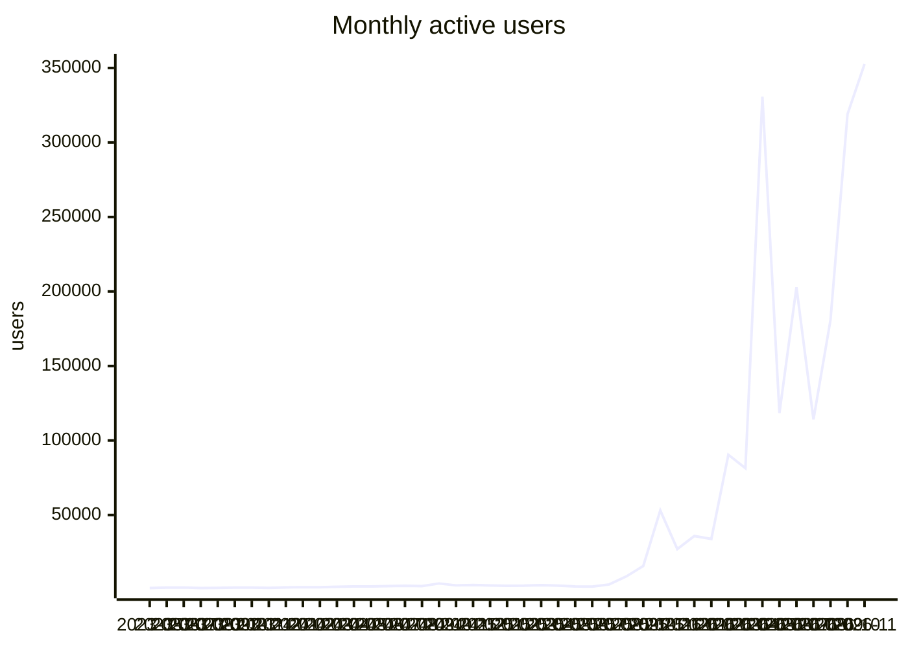

# VFB usage report

Generated 2026-11-16 from aggregate Google Analytics 4 counts for property 375054915, covering 2023-05-10 to 2026-11-15. Source tables: [`analytics/ga4/`](analytics/ga4/). Only summed counts are stored; nothing here identifies a user.

**Reading the numbers.** A large and growing share of 'users' and 'sessions' is automated traffic that loads one page and leaves within a second. Engaged hours (time with the page in the foreground) is barely touched by that traffic and is the most reliable measure of real use; seconds per session shows how bot-heavy a row is.

## Yearly totals

| year | peak monthly users | sessions | screenPageViews | engaged hours | sec/session |
|---|---|---|---|---|---|
| 2023 | 1,332 | 13,668 | 42,490 | 172.9 | 45.5 |
| 2024 | 4,045 | 62,091 | 465,976 | 1,046.3 | 60.7 |
| 2025 | 53,078 | 174,980 | 961,769 | 1,240.7 | 25.5 |
| 2026 | 352,625 | 1,952,263 | 5,026,798 | 4,594.0 | 8.5 |

## Monthly trend

| month | activeUsers | newUsers | sessions | screenPageViews | engaged hours | sec/session |
|---|---|---|---|---|---|---|
| 2024-12 | 2,996 | 2,325 | 6,433 | 42,248 | 80.3 | 45.0 |
| 2025-01 | 2,711 | 1,830 | 7,149 | 57,703 | 94.5 | 47.6 |
| 2025-02 | 2,483 | 1,473 | 6,460 | 69,682 | 130.5 | 72.7 |
| 2025-03 | 2,594 | 1,923 | 7,298 | 70,667 | 93.3 | 46.0 |
| 2025-04 | 2,961 | 2,158 | 5,752 | 46,050 | 107.5 | 67.3 |
| 2025-05 | 2,634 | 1,976 | 5,584 | 49,953 | 203.4 | 131.1 |
| 2025-06 | 2,044 | 1,803 | 5,615 | 39,033 | 60.9 | 39.0 |
| 2025-07 | 1,950 | 1,514 | 6,599 | 43,636 | 67.9 | 37.0 |
| 2025-08 | 3,396 | 3,134 | 8,653 | 67,983 | 113.5 | 47.2 |
| 2025-09 | 8,753 | 10,370 | 15,167 | 293,319 | 97.7 | 23.2 |
| 2025-10 | 15,773 | 15,259 | 19,431 | 62,052 | 89.3 | 16.5 |
| 2025-11 | 53,078 | 51,557 | 55,532 | 92,601 | 97.5 | 6.3 |
| 2025-12 | 27,089 | 26,632 | 30,314 | 69,090 | 84.8 | 10.1 |
| 2026-01 | 35,882 | 35,655 | 41,654 | 84,515 | 93.1 | 8.0 |
| 2026-02 | 33,896 | 33,815 | 38,136 | 81,618 | 89.5 | 8.5 |
| 2026-03 | 90,461 | 89,967 | 95,391 | 204,564 | 189.0 | 7.1 |
| 2026-04 | 81,384 | 81,647 | 85,778 | 152,209 | 110.6 | 4.6 |
| 2026-05 | 330,801 | 328,117 | 328,909 | 419,823 | 495.2 | 5.4 |
| 2026-06 | 118,372 | 120,130 | 125,861 | 215,401 | 120.8 | 3.5 |
| 2026-07 | 202,893 | 200,564 | 203,206 | 285,273 | 141.3 | 2.5 |
| 2026-08 | 114,152 | 116,038 | 121,133 | 261,249 | 223.3 | 6.6 |
| 2026-09 | 180,888 | 183,665 | 230,953 | 1,586,357 | 1,963.3 | 30.6 |
| 2026-10 | 319,023 | 302,918 | 333,450 | 996,586 | 813.6 | 8.8 |
| 2026-11 | 352,625 | 323,412 | 361,653 | 739,203 | 354.3 | 3.5 |

## By site, last 12 months

Page views with no host name are the v2 viewer's in-app term changes and are counted under the viewer.

| site | sessions | screenPageViews | engaged hours | sec/session |
|---|---|---|---|---|
| v2 viewer | 1,075,952 | 3,645,537 | 3,072.1 | 10.3 |
| www / docs | 1,021,990 | 1,125,527 | 1,110.8 | 3.9 |
| other VFB services | 203,460 | 224,538 | 511.3 | 9.0 |
| CATMAID | 39,051 | 38,928 | 45.0 | 4.1 |
| other / mirrors | 84,043 | 9,144 | 21.5 | 0.9 |
| legacy Edinburgh hosts | 144,299 | 144,785 | 15.7 | 0.4 |
| VFBchat | 26 | 30 | 0.0 | 0.4 |

## Countries, last 12 months

Ranked by engaged hours. 212 countries in total.

| country | users (sum of months) | sessions | engaged hours | sec/session |
|---|---|---|---|---|
| United States | 142,233 | 183,496 | 1,456.9 | 28.6 |
| United Kingdom | 19,865 | 30,551 | 729.7 | 86.0 |
| China | 461,705 | 463,561 | 278.5 | 2.2 |
| Germany | 16,849 | 24,590 | 201.6 | 29.5 |
| India | 15,472 | 18,658 | 195.5 | 37.7 |
| Puerto Rico | 251 | 1,608 | 148.6 | 332.8 |
| Hong Kong | 223,053 | 220,986 | 147.5 | 2.4 |
| Canada | 8,515 | 12,247 | 111.8 | 32.9 |
| Brazil | 23,730 | 25,410 | 86.1 | 12.2 |
| Australia | 4,517 | 6,753 | 78.7 | 41.9 |
| Russia | 6,701 | 8,710 | 74.9 | 31.0 |
| Singapore | 948,232 | 939,266 | 64.6 | 0.2 |
| Chile | 3,016 | 3,594 | 63.9 | 64.0 |
| Japan | 10,723 | 12,683 | 58.3 | 16.5 |
| Poland | 3,946 | 5,221 | 50.6 | 34.9 |
| France | 5,109 | 6,677 | 49.6 | 26.8 |
| Türkiye | 5,478 | 6,791 | 49.1 | 26.0 |
| Mexico | 7,733 | 8,570 | 47.3 | 19.9 |
| Spain | 3,551 | 4,675 | 44.8 | 34.5 |
| Italy | 2,864 | 3,592 | 39.5 | 39.6 |
| South Korea | 1,683 | 3,232 | 36.3 | 40.5 |
| Indonesia | 14,503 | 15,131 | 35.3 | 8.4 |
| Netherlands | 3,545 | 4,357 | 33.2 | 27.4 |
| Pakistan | 4,734 | 4,982 | 32.8 | 23.7 |
| Philippines | 5,615 | 6,016 | 29.8 | 17.8 |
| New Zealand | 820 | 1,065 | 26.8 | 90.7 |
| Argentina | 5,998 | 6,461 | 26.4 | 14.7 |
| (not set) | 1,044 | 1,000 | 26.4 | 95.1 |
| Thailand | 2,907 | 3,447 | 24.2 | 25.3 |
| Israel | 1,710 | 2,413 | 23.9 | 35.6 |

## Cities, last 12 months

GA4 has no institution or network dimension, so city is the nearest proxy for where labs are. Cities with fewer than 5 users in a month are not stored. Data-centre cities (Ashburn, Council Bluffs, Singapore and similar) show up with near-zero seconds per session.

| city | country | months seen | sessions | engaged hours | sec/session |
|---|---|---|---|---|---|
| Dunblane | United Kingdom | 1 | 84 | 361.1 | 15,475.0 |
| Hong Kong | Hong Kong | 13 | 220,767 | 144.5 | 2.4 |
| Kashgar Prefecture | China | 3 | 109,214 | 57.8 | 1.9 |
| Singapore | Singapore | 13 | 863,765 | 52.6 | 0.2 |
| San Juan | Puerto Rico | 7 | 702 | 51.9 | 266.2 |
| Santiago | Chile | 12 | 1,883 | 48.3 | 92.3 |
| London | United Kingdom | 13 | 5,334 | 46.1 | 31.1 |
| New York | United States | 13 | 5,012 | 38.3 | 27.5 |
| Urumqi | China | 5 | 76,163 | 30.9 | 1.5 |
| Los Angeles | United States | 13 | 3,274 | 30.6 | 33.6 |
| Chicago | United States | 13 | 5,533 | 27.2 | 17.7 |
| Moscow | Russia | 11 | 2,512 | 24.7 | 35.4 |
| Frederick | United States | 1 | 17 | 24.7 | 5,235.5 |
| Beijing | China | 13 | 12,403 | 24.4 | 7.1 |
| Bengaluru | India | 11 | 2,009 | 24.1 | 43.2 |
| Munich | Germany | 11 | 510 | 24.1 | 170.1 |
| Karachi | Pakistan | 10 | 1,006 | 22.0 | 78.6 |
| Athens | United States | 5 | 450 | 21.2 | 169.2 |
| Round Rock | United States | 2 | 50 | 21.2 | 1,525.3 |
| San Jose | United States | 13 | 5,326 | 20.9 | 14.1 |
| Phoenix | United States | 9 | 4,918 | 20.8 | 15.2 |
| Edinburgh | United Kingdom | 10 | 500 | 19.9 | 143.0 |
| Cambridge | United Kingdom | 13 | 1,863 | 19.1 | 37.0 |
| Auckland | New Zealand | 8 | 465 | 18.9 | 146.2 |
| Sydney | Australia | 10 | 1,957 | 18.5 | 34.0 |
| Istanbul | Türkiye | 12 | 2,303 | 18.2 | 28.5 |
| Flint Hill | United States | 7 | 5,439 | 17.7 | 11.7 |
| Cologne | Germany | 11 | 766 | 17.7 | 83.3 |
| Melbourne | Australia | 9 | 1,515 | 17.0 | 40.4 |
| Houston | United States | 13 | 2,174 | 16.4 | 27.2 |
| Miami | United States | 11 | 822 | 16.0 | 69.9 |
| Dallas | United States | 13 | 1,944 | 15.8 | 29.2 |
| Toronto | Canada | 13 | 1,759 | 15.5 | 31.7 |
| Atlanta | United States | 13 | 1,267 | 15.5 | 44.1 |
| Boston | United States | 13 | 2,019 | 15.2 | 27.0 |
| Brisbane | Australia | 9 | 1,116 | 14.4 | 46.3 |
| Harbin | China | 5 | 7,989 | 13.9 | 6.2 |
| Warsaw | Poland | 13 | 1,667 | 13.9 | 30.1 |
| Berlin | Germany | 13 | 1,102 | 12.4 | 40.6 |
| Seattle | United States | 12 | 1,416 | 11.8 | 30.1 |
| Paris | France | 13 | 1,181 | 11.7 | 35.6 |
| Shanghai | China | 13 | 7,684 | 11.6 | 5.4 |
| Seoul | South Korea | 13 | 1,106 | 11.5 | 37.5 |
| Des Moines | United States | 11 | 3,936 | 11.1 | 10.1 |
| Philadelphia | United States | 13 | 1,459 | 11.0 | 27.1 |
| Bangkok | Thailand | 9 | 1,459 | 10.9 | 26.8 |
| Rostock | Germany | 2 | 144 | 10.7 | 268.7 |
| Ashburn | United States | 13 | 7,211 | 10.7 | 5.4 |
| Mumbai | India | 12 | 1,009 | 10.6 | 37.8 |
| Shenzhen | China | 13 | 1,833 | 10.6 | 20.8 |

## Most viewed terms

Taken from the term id in viewer URLs and `/reports/` and `/term/` pages. The adult brain template leads because it is the default scene, not because people search for it.

### Last 30 days

| term | label | views | engaged hours | days seen |
|---|---|---|---|---|
| VFB_00101567 | JRC2018Unisex | 373,329 | 113.5 | 30 |
| FBbt_00003624 | adult brain | 17,365 | 5.3 | 30 |
| VFB_00108w0p | BANC:brain_neuropil on JRC2018Unisex | 8,983 | 3.4 | 30 |
| FBbt_00003748 | medulla | 8,471 | 3.0 | 30 |
| FBbt_00003681 | adult lateral accessory lobe | 6,858 | 1.7 | 30 |
| VFBexp_FBtp0104 |  | 6,074 | 1.0 | 30 |
| VFBexp_FBtp0105 |  | 5,822 | 0.9 | 30 |
| VFBexp_FBtp0101 |  | 5,798 | 0.9 | 30 |
| VFBexp_FBtp0103 |  | 5,793 | 0.9 | 30 |
| FBbt_00005093 | nervous system | 5,744 | 1.3 | 30 |
| VFBexp_FBtp0100 |  | 5,504 | 0.9 | 29 |
| VFBexp_FBtp0121 |  | 5,489 | 0.7 | 30 |
| VFBexp_FBtp0122 |  | 5,448 | 0.7 | 29 |
| VFBexp_FBtp0106 |  | 5,420 | 0.9 | 30 |
| VFBexp_FBtp0102 |  | 5,392 | 0.8 | 30 |
| FBbt_00040041 | vest | 5,048 | 1.4 | 30 |
| VFBexp_FBtp0107 |  | 5,031 | 0.8 | 30 |
| FBbt_00040043 | anterior ventrolateral protocerebrum | 4,893 | 1.5 | 30 |
| FBbt_00045048 | saddle | 4,404 | 48.8 | 30 |
| VFBexp_FBtp0123 |  | 4,315 | 0.6 | 30 |
| VFBexp_FBtp0124 |  | 4,031 | 0.6 | 30 |
| FBbt_00003004 | adult | 3,846 | 1.2 | 30 |
| VFBexp_FBtp0099 |  | 3,631 | 0.5 | 30 |
| FBbt_00047887 | adult central brain | 3,490 | 0.6 | 30 |
| FBbt_00040042 | posterior ventrolateral protocerebrum | 3,137 | 0.9 | 30 |

### Last 12 months

| term | label | views | engaged hours | days seen |
|---|---|---|---|---|
| VFB_00101567 | JRC2018Unisex | 1,145,718 | 1,704.8 | 365 |
| FBbt_00003624 | adult brain | 94,712 | 50.5 | 337 |
| FBbt_00003748 | medulla | 71,470 | 40.0 | 346 |
| FBbt_00003681 | adult lateral accessory lobe | 57,926 | 28.6 | 343 |
| FBbt_00040041 | vest | 48,310 | 23.0 | 330 |
| FBbt_00005093 | nervous system | 42,857 | 20.1 | 313 |
| FBbt_00040043 | anterior ventrolateral protocerebrum | 40,765 | 19.7 | 309 |
| FBbt_00045048 | saddle | 39,052 | 64.1 | 311 |
| FBbt_00003004 | adult | 36,430 | 16.8 | 297 |
| FBbt_00003680 | nodulus | 34,716 | 8.0 | 258 |
| FBbt_00047887 | adult central brain | 29,641 | 9.7 | 290 |
| FBbt_00040042 | posterior ventrolateral protocerebrum | 27,824 | 12.5 | 296 |
| VFB_00108w0p | BANC:brain_neuropil on JRC2018Unisex | 24,284 | 9.6 | 70 |
| FBbt_00003678 | ellipsoid body | 22,434 | 12.7 | 296 |
| VFB_jrchk7yg | WEDPN2A_R (FlyEM-HB:885788485) | 22,162 | 6.0 | 178 |
| FBbt_00014013 | adult gnathal ganglion | 21,527 | 12.6 | 282 |
| FBbt_00045027 | wedge | 20,983 | 9.0 | 287 |
| VFB_00050000 | L1 larval CNS ssTEM - Cardona/Janelia | 18,457 | 32.1 | 326 |
| FBbt_00007050 | adult cerebrum | 17,753 | 6.3 | 271 |
| VFB_00102107 | ME on JRC2018Unisex adult brain | 16,914 | 11.2 | 256 |
| FBbt_00045050 | flange | 15,161 | 6.5 | 252 |
| FBbt_00003632 | adult central complex | 14,372 | 5.1 | 220 |
| FBbt_00110636 | adult cerebral ganglion | 14,072 | 5.3 | 261 |
| FBbt_00053384 | adult primary visual center | 14,027 | 6.1 | 222 |
| FBbt_00003679 | fan-shaped body | 13,662 | 6.4 | 270 |

### All time

| term | label | views | engaged hours | days seen |
|---|---|---|---|---|
| VFB_00101567 | JRC2018Unisex | 1,349,679 | 1,950.4 | 1,005 |
| FBbt_00003624 | adult brain | 108,088 | 74.1 | 892 |
| FBbt_00003748 | medulla | 81,469 | 61.1 | 883 |
| FBbt_00003681 | adult lateral accessory lobe | 64,521 | 42.9 | 855 |
| FBbt_00040041 | vest | 54,658 | 34.6 | 827 |
| FBbt_00040043 | anterior ventrolateral protocerebrum | 46,078 | 29.9 | 750 |
| FBbt_00005093 | nervous system | 44,541 | 22.8 | 463 |
| FBbt_00045048 | saddle | 43,490 | 73.1 | 761 |
| FBbt_00003004 | adult | 38,889 | 19.5 | 503 |
| FBbt_00003680 | nodulus | 36,575 | 12.1 | 556 |
| FBbt_00047887 | adult central brain | 34,268 | 16.2 | 677 |
| FBbt_00040042 | posterior ventrolateral protocerebrum | 31,167 | 20.0 | 703 |
| VFB_00050000 | L1 larval CNS ssTEM - Cardona/Janelia | 26,458 | 45.2 | 823 |
| FBbt_00003678 | ellipsoid body | 25,732 | 19.6 | 662 |
| FBbt_00014013 | adult gnathal ganglion | 25,265 | 21.3 | 662 |
| VFB_00108w0p | BANC:brain_neuropil on JRC2018Unisex | 24,284 | 9.6 | 70 |
| FBbt_00045027 | wedge | 23,692 | 15.1 | 658 |
| VFB_jrchk7yg | WEDPN2A_R (FlyEM-HB:885788485) | 22,333 | 6.7 | 191 |
| VFB_00102107 | ME on JRC2018Unisex adult brain | 20,823 | 16.1 | 551 |
| FBbt_00007050 | adult cerebrum | 20,681 | 10.6 | 576 |
| FBbt_00003679 | fan-shaped body | 19,120 | 12.8 | 618 |
| VFB_00030867 | adult mushroom body on adult brain template JFRC2 | 17,527 | 13.1 | 455 |
| FBbt_00045050 | flange | 17,246 | 11.1 | 557 |
| FBbt_00110636 | adult cerebral ganglion | 16,630 | 8.5 | 562 |
| FBbt_00003632 | adult central complex | 16,296 | 8.8 | 430 |

### Templates in use, last 12 months

| template | label | views |
|---|---|---|
| VFB_00101567 | JRC2018Unisex | 1,740,434 |
| VFB_00050000 | L1 larval CNS ssTEM - Cardona/Janelia | 37,294 |
| VFB_00200000 | JRC2018UnisexVNC | 22,701 |
| VFB_00017894 | adult brain template JFRC2 | 19,867 |
| VFB_00049000 | L3 CNS template - Wood2018 | 10,326 |
| VFB_00101384 | JRC_FlyEM_Hemibrain | 6,005 |
| VFB_00110000 | Adult Head (McKellar2020) | 3,428 |
| VFB_00120000 | Adult T1 Leg (Kuan2020) | 2,223 |
| FBbt_00003624 | adult brain | 1,385 |
| VFB_00100000 | adult VNS template - Court2018 | 1,325 |

## Website and documentation pages, last 12 months

| pagePath | screenPageViews | engaged hours |
|---|---|---|
| / | 226,810 | 648.2 |
| /docs/ | 20,430 | 47.4 |
| /about/ | 6,720 | 29.5 |
| /docs/overview/ | 4,394 | 24.9 |
| /blog/releases/catmaid/ | 547 | 22.4 |
| /docs/data/ | 6,752 | 22.1 |
| /docs/tutorials/vfb-mcp-guide/ | 1,984 | 11.2 |
| /docs/website-features/3dviewer/ | 2,947 | 10.8 |
| /docs/tutorials/ | 2,801 | 6.6 |
| /hosted/ | 3,161 | 6.6 |
| /docs/contribution-guidelines/ | 1,467 | 5.8 |
| /about/whichfly/ | 545 | 5.5 |
| /docs/website-features/search_query/ | 903 | 4.0 |
| /blog/news/ | 1,725 | 3.9 |
| /docs/tutorials/apis/ | 831 | 3.8 |
| /docs/apis/ | 786 | 3.8 |
| /docs/concepts/flylight_tiles/ | 643 | 3.7 |
| /blog/2026/09/06/vfb-self-led-learning-sessions-a-free-online-workshop-open-to-everyone/ | 1,197 | 3.5 |
| /docs/website-features/ | 1,237 | 3.2 |
| /docs/concepts/ | 600 | 2.8 |
| /docs/data/em/ | 534 | 2.6 |
| /docs/concepts/neuron-counts/ | 330 | 2.6 |
| /docs/tutorials/apis/vfb_api_overview/ | 385 | 2.4 |
| /docs/website-features/download/ | 636 | 2.4 |
| /docs/concepts/cell_types/ | 391 | 2.4 |
| /docs/tutorials/website/similarityscore/ | 358 | 2.3 |
| /docs/tutorials/website/bulkdownloads/ | 579 | 2.3 |
| /about/hosted/ | 934 | 2.3 |
| /docs/tools/ | 438 | 2.2 |
| /about/whatisvfb/ | 662 | 2.1 |

## How people arrive

Engaged sessions by channel and year.

| channel | 2023 | 2024 | 2025 | 2026 |
|---|---|---|---|---|
| AI Assistant | 0 | 0 | 0 | 2,599 |
| Direct | 1,628 | 10,737 | 124,445 | 1,679,686 |
| Organic Search | 3,198 | 18,605 | 30,520 | 201,502 |
| Organic Shopping | 0 | 3 | 2 | 0 |
| Organic Social | 7 | 454 | 125 | 1,448 |
| Organic Video | 0 | 2 | 0 | 145 |
| Referral | 495 | 18,973 | 11,071 | 10,319 |
| Unassigned | 0 | 6 | 60 | 1,556 |

Top sources, last 12 months.

| sessionSource | sessions | engaged hours |
|---|---|---|
| google | 192,346 | 2,512.7 |
| (direct) | 1,727,532 | 1,484.6 |
| bing | 14,287 | 296.4 |
| (not set) | 47,880 | 82.3 |
| chatgpt.com | 2,818 | 38.8 |
| yahoo | 869 | 32.8 |
| duckduckgo | 2,802 | 32.0 |
| cn.bing.com | 816 | 28.4 |
| splitgal4.janelia.org | 1,555 | 14.6 |
| codex.flywire.ai | 1,644 | 14.0 |
| gemini.google.com | 587 | 13.9 |
| flybase.org | 923 | 13.6 |
| ecosia.org | 799 | 9.8 |
| github.com | 647 | 9.4 |
| moodle.carleton.edu | 120 | 6.3 |
| trafficheap.cc | 502 | 5.8 |
| trafficheap.com | 502 | 5.8 |
| en.wikipedia.org | 340 | 5.5 |
| science.org | 148 | 5.3 |
| janelia.org | 171 | 5.1 |
| search.brave.com | 315 | 5.0 |
| yandex.ru | 252 | 4.0 |
| neuronbridge.janelia.org | 87 | 3.8 |
| translate.google.com | 222 | 3.6 |
| cell.com | 223 | 3.5 |

## Queries run in the viewer, last 12 months

| query | runs |
|---|---|
| neuronneuronconnectivit | 10,819 |
| neuronregionconnectivit | 8,430 |
| similarmorphologyto | 6,896 |
| listallavailableimages | 5,885 |
| allalignedimages | 5,498 |
| findstocks | 4,241 |
| anatomyexpressedin | 3,773 |
| imagesneurons | 2,844 |
| epfrag | 1,783 |
| similarmorphologytonb | 1,354 |
| neuronsparthere | 1,101 |
| downstreamclassconnecti | 1,044 |
| upstreamclassconnectivi | 1,030 |
| alldatasets | 965 |
| aligneddatasets | 935 |
| similarmorphologytopart | 772 |
| partsof | 693 |
| subclassesof | 524 |
| painteddomains | 409 |
| neuronssynaptic | 335 |
| transgeneexpressionhere | 331 |
| targetneurons | 279 |
| neuronspostsynaptichere | 247 |
| neuronspresynaptichere | 227 |
| datasetimages | 167 |

## VFBchat and MCP

| month | chat_query | mcp_tool_call |
|---|---|---|
| 2026-02 | 70 | 492 |
| 2026-03 | 354 | 2,258 |
| 2026-04 | 575 | 7,992 |
| 2026-05 | 17 | 971 |
| 2026-06 | 358 | 30,858 |
| 2026-07 | 9 | 18,938 |
| 2026-08 | 1,017 | 89,583 |
| 2026-09 | 797 | 84,835 |
| 2026-10 | 224 | 28,191 |
| 2026-11 | 37 | 14,744 |

## Viewer reliability

| month | session_start | disconnected | reconnected-resumed | reconnect-failed-reloading | reconnect-exhausted | disconnects per 100 sessions |
|---|---|---|---|---|---|---|
| 2025-06 | 3,466 | 1,365 | 0 | 12 | 0 | 39.4 |
| 2025-07 | 4,662 | 2,057 | 0 | 18 | 0 | 44.1 |
| 2025-08 | 6,571 | 1,680 | 0 | 17 | 0 | 25.6 |
| 2025-09 | 6,265 | 1,170 | 0 | 24 | 0 | 18.7 |
| 2025-10 | 7,777 | 1,232 | 0 | 17 | 0 | 15.8 |
| 2025-11 | 8,460 | 1,163 | 0 | 24 | 0 | 13.7 |
| 2025-12 | 10,434 | 1,359 | 0 | 8 | 0 | 13.0 |
| 2026-01 | 21,913 | 1,530 | 0 | 30 | 0 | 7.0 |
| 2026-02 | 24,790 | 1,536 | 0 | 31 | 0 | 6.2 |
| 2026-03 | 23,808 | 5,059 | 0 | 465 | 0 | 21.2 |
| 2026-04 | 23,996 | 2,933 | 0 | 33 | 0 | 12.2 |
| 2026-05 | 55,407 | 2,314 | 0 | 44 | 0 | 4.2 |
| 2026-06 | 23,505 | 2,149 | 0 | 158 | 0 | 9.1 |
| 2026-07 | 45,208 | 2,280 | 0 | 49 | 0 | 5.0 |
| 2026-08 | 24,841 | 3,675 | 0 | 530 | 0 | 14.8 |
| 2026-09 | 51,588 | 75,199 | 30,436 | 38,791 | 1,919 | 145.8 |
| 2026-10 | 142,443 | 15,122 | 6,573 | 7,432 | 588 | 10.6 |
| 2026-11 | 143,869 | 18 | 0 | 0 | 3 | 0.0 |

Load times from the timing suffix on viewer events (months with at least 100 samples).

| month | event | n | median s | p95 s |
|---|---|---|---|---|
| 2026-09 | direct-geom:obj:ok | 61,923 | 1.4 | 25.4 |
| 2026-10 | direct-geom:obj:ok | 107,017 | 3.7 | 8.1 |
| 2026-11 | direct-geom:obj:ok | 75,115 | 3.7 | 6.4 |
| 2026-09 | direct-terminfo:ok | 109,210 | 0.4 | 3.0 |
| 2026-10 | direct-terminfo:ok | 271,878 | 0.7 | 2.4 |
| 2026-11 | direct-terminfo:ok | 167,289 | 0.8 | 5.5 |
| 2026-09 | startup-first-term | 50,164 | 5.2 | 58.0 |
| 2026-10 | startup-first-term | 100,642 | 6.1 | 16.0 |
| 2026-11 | startup-first-term | 77,074 | 6.1 | 14.0 |
| 2026-09 | startup-model | 54,086 | 2.8 | 25.0 |
| 2026-10 | startup-model | 158,414 | 1.3 | 5.2 |
| 2026-11 | startup-model | 141,050 | 1.3 | 3.0 |
| 2026-09 | term-load:ok | 104,726 | 1.0 | 45.0 |
| 2026-10 | term-load:ok | 167,247 | 3.9 | 11.0 |
| 2026-11 | term-load:ok | 99,474 | 4.6 | 12.0 |

## Outbound links clicked, last 12 months

| linkDomain | clicks |
|---|---|
| virtualflybrain.org | 1,577 |
| neuronbridge.janelia.org | 1,436 |
| pypi.org | 1,398 |
| github.com | 968 |
| v2.virtualflybrain.org | 702 |
| insectbraindb.org | 661 |
| flweb.janelia.org | 442 |
| colab.research.google.com | 415 |
| translate.google.com | 392 |
| doi.org | 367 |
| flybase.org | 213 |
| chat.virtualflybrain.org | 100 |
| virtualflybrain.bsky.social | 89 |
| codex.flywire.ai | 88 |
| vfb3-mcp.virtualflybrain.org | 59 |
| google.com | 57 |
| neurofly.org | 51 |
| neuprint.janelia.org | 49 |
| janelia.org | 49 |
| zenodo.org | 36 |

## Devices and browsers, last 12 months

| deviceCategory | browser | sessions | engaged hours |
|---|---|---|---|
| desktop | Chrome | 1,844,591 | 3,017.9 |
| desktop | Edge | 22,371 | 470.1 |
| mobile | Chrome | 48,885 | 355.5 |
| desktop | Safari | 15,560 | 212.2 |
| desktop | Firefox | 11,844 | 207.4 |
| desktop | Opera | 14,490 | 177.7 |
| mobile | Safari | 34,805 | 166.6 |
| tablet | Chrome | 2,926 | 38.5 |
| tablet | Safari | 1,058 | 12.9 |
| mobile | Samsung Internet | 1,604 | 11.3 |
| mobile | Firefox | 1,284 | 11.3 |
| desktop | YaBrowser | 525 | 7.9 |

## What this data cannot show

- **Institutions.** GA4 dropped the network-domain dimension and never exposes IP addresses. City is as close as it gets.
- **Search terms typed into VFB.** The viewer does not send a `search` event, so `searchTerm` is empty. Term popularity above comes from term ids in URLs.
- **Event detail.** No custom dimensions are registered on the property, so event parameters (`event_label`, `event_category`, and the VFBchat and MCP parameters such as tool name and topic) are discarded from reports. Registration is not retroactive.
- **Yearly unique users.** Users do not add up across days or months; only daily and monthly uniques are stored.
