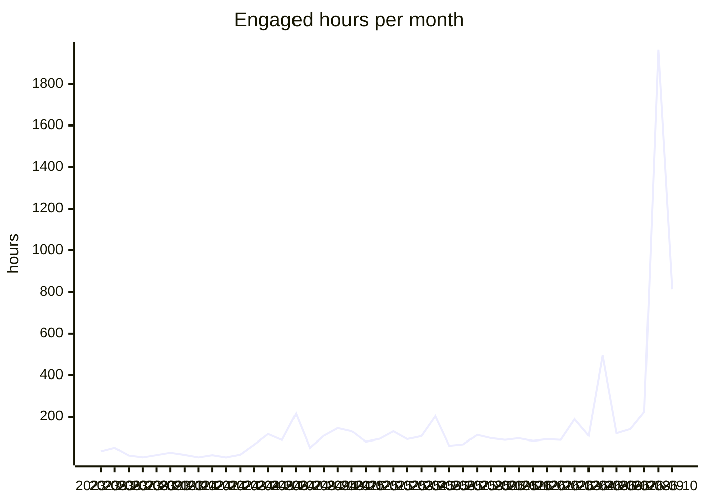
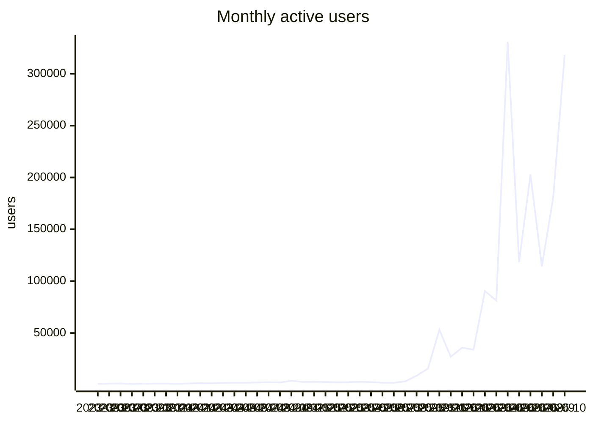

# VFB usage report

Generated 2026-11-01 from aggregate Google Analytics 4 counts for property 375054915, covering 2023-05-10 to 2026-10-31. Source tables: [`analytics/ga4/`](analytics/ga4/). Only summed counts are stored; nothing here identifies a user.

**Reading the numbers.** A large and growing share of 'users' and 'sessions' is automated traffic that loads one page and leaves within a second. Engaged hours (time with the page in the foreground) is barely touched by that traffic and is the most reliable measure of real use; seconds per session shows how bot-heavy a row is.

## Yearly totals

| year | peak monthly users | sessions | screenPageViews | engaged hours | sec/session |
|---|---|---|---|---|---|
| 2023 | 1,332 | 13,668 | 42,490 | 172.9 | 45.5 |
| 2024 | 4,045 | 62,091 | 465,976 | 1,046.3 | 60.7 |
| 2025 | 53,078 | 174,980 | 961,769 | 1,240.7 | 25.5 |
| 2026 | 330,801 | 1,599,249 | 4,285,064 | 4,238.7 | 9.5 |

## Monthly trend

| month | activeUsers | newUsers | sessions | screenPageViews | engaged hours | sec/session |
|---|---|---|---|---|---|---|
| 2024-11 | 2,756 | 2,307 | 7,746 | 71,342 | 131.2 | 61.0 |
| 2024-12 | 2,996 | 2,325 | 6,433 | 42,248 | 80.3 | 45.0 |
| 2025-01 | 2,711 | 1,830 | 7,149 | 57,703 | 94.5 | 47.6 |
| 2025-02 | 2,483 | 1,473 | 6,460 | 69,682 | 130.5 | 72.7 |
| 2025-03 | 2,594 | 1,923 | 7,298 | 70,667 | 93.3 | 46.0 |
| 2025-04 | 2,961 | 2,158 | 5,752 | 46,050 | 107.5 | 67.3 |
| 2025-05 | 2,634 | 1,976 | 5,584 | 49,953 | 203.4 | 131.1 |
| 2025-06 | 2,044 | 1,803 | 5,615 | 39,033 | 60.9 | 39.0 |
| 2025-07 | 1,950 | 1,514 | 6,599 | 43,636 | 67.9 | 37.0 |
| 2025-08 | 3,396 | 3,134 | 8,653 | 67,983 | 113.5 | 47.2 |
| 2025-09 | 8,753 | 10,370 | 15,167 | 293,319 | 97.7 | 23.2 |
| 2025-10 | 15,773 | 15,259 | 19,431 | 62,052 | 89.3 | 16.5 |
| 2025-11 | 53,078 | 51,557 | 55,532 | 92,601 | 97.5 | 6.3 |
| 2025-12 | 27,089 | 26,632 | 30,314 | 69,090 | 84.8 | 10.1 |
| 2026-01 | 35,882 | 35,655 | 41,654 | 84,515 | 93.1 | 8.0 |
| 2026-02 | 33,896 | 33,815 | 38,136 | 81,618 | 89.5 | 8.5 |
| 2026-03 | 90,461 | 89,967 | 95,391 | 204,564 | 189.0 | 7.1 |
| 2026-04 | 81,384 | 81,647 | 85,778 | 152,209 | 110.6 | 4.6 |
| 2026-05 | 330,801 | 328,117 | 328,909 | 419,823 | 495.2 | 5.4 |
| 2026-06 | 118,372 | 120,130 | 125,861 | 215,401 | 120.8 | 3.5 |
| 2026-07 | 202,893 | 200,564 | 203,206 | 285,273 | 141.3 | 2.5 |
| 2026-08 | 114,152 | 116,038 | 121,133 | 261,249 | 223.3 | 6.6 |
| 2026-09 | 180,888 | 183,665 | 230,953 | 1,586,357 | 1,963.3 | 30.6 |
| 2026-10 | 318,117 | 302,254 | 332,002 | 994,055 | 812.5 | 8.8 |

## By site, last 12 months

Page views with no host name are the v2 viewer's in-app term changes and are counted under the viewer.

| site | sessions | screenPageViews | engaged hours | sec/session |
|---|---|---|---|---|
| v2 viewer | 792,352 | 3,105,077 | 2,835.8 | 12.9 |
| www / docs | 854,716 | 953,835 | 1,050.1 | 4.4 |
| other VFB services | 187,152 | 198,671 | 455.6 | 8.8 |
| CATMAID | 38,568 | 38,428 | 43.3 | 4.0 |
| other / mirrors | 83,849 | 8,844 | 20.6 | 0.9 |
| legacy Edinburgh hosts | 141,389 | 141,870 | 15.6 | 0.4 |
| VFBchat | 26 | 30 | 0.0 | 0.4 |

## Countries, last 12 months

Ranked by engaged hours. 212 countries in total.

| country | users (sum of months) | sessions | engaged hours | sec/session |
|---|---|---|---|---|
| United States | 120,359 | 160,849 | 1,373.2 | 30.7 |
| United Kingdom | 17,020 | 27,516 | 715.8 | 93.6 |
| Germany | 14,744 | 22,297 | 191.2 | 30.9 |
| India | 14,941 | 18,020 | 188.9 | 37.7 |
| China | 284,767 | 288,333 | 172.9 | 2.2 |
| Puerto Rico | 236 | 1,591 | 148.6 | 336.1 |
| Canada | 7,899 | 11,534 | 106.4 | 33.2 |
| Hong Kong | 123,410 | 124,235 | 96.0 | 2.8 |
| Brazil | 20,322 | 21,939 | 83.3 | 13.7 |
| Australia | 4,229 | 6,334 | 73.7 | 41.9 |
| Russia | 6,282 | 8,175 | 73.3 | 32.3 |
| Chile | 2,710 | 3,274 | 61.2 | 67.3 |
| Singapore | 870,680 | 863,781 | 59.6 | 0.2 |
| Japan | 9,848 | 11,778 | 55.9 | 17.1 |
| Poland | 3,726 | 4,917 | 47.8 | 35.0 |
| Türkiye | 5,246 | 6,541 | 47.6 | 26.2 |
| France | 4,439 | 5,953 | 47.6 | 28.8 |
| Mexico | 6,859 | 7,665 | 45.8 | 21.5 |
| Spain | 3,175 | 4,267 | 42.5 | 35.9 |
| Italy | 2,654 | 3,358 | 38.4 | 41.2 |
| Indonesia | 13,232 | 13,832 | 33.5 | 8.7 |
| South Korea | 1,599 | 3,094 | 32.0 | 37.2 |
| Pakistan | 4,320 | 4,558 | 31.7 | 25.1 |
| Netherlands | 3,298 | 4,073 | 30.8 | 27.2 |
| Philippines | 5,165 | 5,537 | 28.5 | 18.5 |
| (not set) | 1,029 | 986 | 26.4 | 96.4 |
| Argentina | 5,084 | 5,533 | 25.2 | 16.4 |
| Israel | 1,592 | 2,266 | 23.2 | 36.8 |
| Thailand | 2,459 | 2,982 | 23.1 | 27.9 |
| Taiwan | 950 | 1,620 | 21.7 | 48.2 |

## Cities, last 12 months

GA4 has no institution or network dimension, so city is the nearest proxy for where labs are. Cities with fewer than 5 users in a month are not stored. Data-centre cities (Ashburn, Council Bluffs, Singapore and similar) show up with near-zero seconds per session.

| city | country | months seen | sessions | engaged hours | sec/session |
|---|---|---|---|---|---|
| Dunblane | United Kingdom | 1 | 84 | 361.1 | 15,475.0 |
| Hong Kong | Hong Kong | 12 | 122,404 | 93.0 | 2.7 |
| San Juan | Puerto Rico | 7 | 702 | 51.9 | 266.2 |
| Singapore | Singapore | 12 | 843,318 | 51.0 | 0.2 |
| Santiago | Chile | 11 | 1,736 | 46.3 | 96.0 |
| London | United Kingdom | 12 | 5,024 | 44.0 | 31.6 |
| New York | United States | 12 | 4,383 | 36.4 | 29.9 |
| Los Angeles | United States | 12 | 3,045 | 28.5 | 33.7 |
| Chicago | United States | 12 | 5,275 | 26.6 | 18.1 |
| Frederick | United States | 1 | 17 | 24.7 | 5,235.5 |
| Urumqi | China | 4 | 63,576 | 24.4 | 1.4 |
| Moscow | Russia | 10 | 2,406 | 24.3 | 36.3 |
| Munich | Germany | 10 | 477 | 23.9 | 180.6 |
| Bengaluru | India | 10 | 1,937 | 23.2 | 43.1 |
| Karachi | Pakistan | 9 | 925 | 21.4 | 83.2 |
| Round Rock | United States | 2 | 50 | 21.2 | 1,525.3 |
| Phoenix | United States | 8 | 4,553 | 19.6 | 15.5 |
| San Jose | United States | 12 | 4,910 | 19.4 | 14.3 |
| Cambridge | United Kingdom | 12 | 1,847 | 18.9 | 36.8 |
| Edinburgh | United Kingdom | 9 | 456 | 18.9 | 149.2 |
| Istanbul | Türkiye | 11 | 2,221 | 17.8 | 28.8 |
| Sydney | Australia | 9 | 1,860 | 17.5 | 33.9 |
| Athens | United States | 4 | 386 | 16.9 | 157.4 |
| Flint Hill | United States | 6 | 5,134 | 16.7 | 11.7 |
| Melbourne | Australia | 8 | 1,414 | 16.1 | 40.9 |
| Cologne | Germany | 10 | 730 | 15.9 | 78.3 |
| Miami | United States | 10 | 737 | 15.8 | 77.4 |
| Houston | United States | 12 | 2,004 | 15.6 | 28.1 |
| Dallas | United States | 12 | 1,851 | 15.3 | 29.7 |
| Toronto | Canada | 12 | 1,658 | 15.1 | 32.7 |
| Boston | United States | 12 | 1,955 | 15.0 | 27.7 |
| Atlanta | United States | 12 | 1,163 | 14.7 | 45.7 |
| Brisbane | Australia | 8 | 1,007 | 13.6 | 48.6 |
| Beijing | China | 12 | 4,415 | 13.5 | 11.0 |
| Warsaw | Poland | 12 | 1,585 | 13.3 | 30.3 |
| Berlin | Germany | 12 | 1,033 | 12.0 | 42.0 |
| Paris | France | 12 | 1,117 | 11.4 | 36.9 |
| Shanghai | China | 12 | 7,594 | 11.4 | 5.4 |
| Seoul | South Korea | 12 | 1,076 | 11.2 | 37.6 |
| Seattle | United States | 11 | 1,336 | 10.8 | 29.1 |
| Rostock | Germany | 2 | 144 | 10.7 | 268.7 |
| Shenzhen | China | 12 | 1,793 | 10.5 | 21.0 |
| Bangkok | Thailand | 8 | 1,305 | 10.4 | 28.6 |
| Philadelphia | United States | 12 | 1,254 | 10.4 | 29.9 |
| Des Moines | United States | 10 | 3,589 | 10.2 | 10.2 |
| Mumbai | India | 11 | 969 | 10.0 | 37.1 |
| Ashburn | United States | 12 | 5,307 | 9.6 | 6.5 |
| San Francisco | United States | 10 | 1,401 | 9.5 | 24.4 |
| Mexico City | Mexico | 10 | 1,448 | 9.5 | 23.7 |
| Sao Paulo | Brazil | 10 | 1,920 | 9.5 | 17.7 |

## Most viewed terms

Taken from the term id in viewer URLs and `/reports/` and `/term/` pages. The adult brain template leads because it is the default scene, not because people search for it.

### Last 30 days

| term | label | views | engaged hours | days seen |
|---|---|---|---|---|
| VFB_00101567 | JRC2018Unisex | 232,529 | 231.1 | 30 |
| FBbt_00003624 | adult brain | 27,636 | 12.6 | 30 |
| FBbt_00003748 | medulla | 12,875 | 5.0 | 30 |
| FBbt_00003681 | adult lateral accessory lobe | 10,357 | 3.4 | 30 |
| FBbt_00005093 | nervous system | 8,559 | 3.2 | 30 |
| FBbt_00040041 | vest | 8,061 | 2.2 | 30 |
| VFB_00108w0p | BANC:brain_neuropil on JRC2018Unisex | 7,991 | 3.3 | 30 |
| FBbt_00003680 | nodulus | 7,384 | 1.0 | 30 |
| FBbt_00045048 | saddle | 6,677 | 50.1 | 30 |
| FBbt_00040043 | anterior ventrolateral protocerebrum | 6,673 | 2.4 | 30 |
| FBbt_00007146 | adult deutocerebrum | 6,074 | 0.1 | 29 |
| FBbt_00003004 | adult | 5,799 | 2.1 | 30 |
| FBbt_00047887 | adult central brain | 5,026 | 1.3 | 30 |
| FBbt_00040042 | posterior ventrolateral protocerebrum | 4,619 | 1.7 | 30 |
| VFBexp_FBtp0121 |  | 3,941 | 0.3 | 28 |
| FBbt_00045027 | wedge | 3,792 | 1.3 | 30 |
| FBbt_00003678 | ellipsoid body | 3,746 | 1.3 | 30 |
| VFBexp_FBtp0122 |  | 3,656 | 0.5 | 24 |
| FBbt_00014013 | adult gnathal ganglion | 3,549 | 1.2 | 30 |
| VFBexp_FBtp0104 |  | 3,503 | 0.3 | 20 |
| VFBexp_FBtp0103 |  | 3,421 | 0.4 | 20 |
| VFBexp_FBtp0101 |  | 3,286 | 0.3 | 20 |
| VFBexp_FBtp0105 |  | 3,246 | 0.3 | 20 |
| VFBexp_FBtp0100 |  | 3,230 | 0.3 | 19 |
| VFB_jrchk7yg | WEDPN2A_R (FlyEM-HB:885788485) | 3,225 | 0.3 | 28 |

### Last 12 months

| term | label | views | engaged hours | days seen |
|---|---|---|---|---|
| VFB_00101567 | JRC2018Unisex | 935,734 | 1,656.4 | 365 |
| FBbt_00003624 | adult brain | 89,272 | 49.3 | 334 |
| FBbt_00003748 | medulla | 68,199 | 39.0 | 346 |
| FBbt_00003681 | adult lateral accessory lobe | 55,462 | 28.0 | 341 |
| FBbt_00040041 | vest | 46,067 | 22.5 | 325 |
| FBbt_00005093 | nervous system | 40,621 | 19.6 | 307 |
| FBbt_00040043 | anterior ventrolateral protocerebrum | 38,873 | 19.6 | 303 |
| FBbt_00045048 | saddle | 37,381 | 63.8 | 305 |
| FBbt_00003004 | adult | 34,944 | 16.4 | 288 |
| FBbt_00003680 | nodulus | 33,860 | 8.1 | 250 |
| FBbt_00047887 | adult central brain | 28,546 | 9.4 | 282 |
| FBbt_00040042 | posterior ventrolateral protocerebrum | 26,551 | 12.4 | 293 |
| FBbt_00003678 | ellipsoid body | 21,491 | 12.7 | 290 |
| VFB_jrchk7yg | WEDPN2A_R (FlyEM-HB:885788485) | 20,690 | 5.9 | 164 |
| FBbt_00014013 | adult gnathal ganglion | 20,452 | 12.4 | 276 |
| FBbt_00045027 | wedge | 19,879 | 8.7 | 278 |
| VFB_00108w0p | BANC:brain_neuropil on JRC2018Unisex | 19,553 | 8.1 | 55 |
| VFB_00050000 | L1 larval CNS ssTEM - Cardona/Janelia | 18,033 | 30.5 | 324 |
| FBbt_00007050 | adult cerebrum | 17,104 | 6.1 | 263 |
| VFB_00102107 | ME on JRC2018Unisex adult brain | 16,060 | 11.0 | 247 |
| FBbt_00045050 | flange | 14,518 | 6.4 | 245 |
| FBbt_00003632 | adult central complex | 13,723 | 4.7 | 207 |
| FBbt_00110636 | adult cerebral ganglion | 13,429 | 5.2 | 250 |
| FBbt_00053384 | adult primary visual center | 13,386 | 5.9 | 211 |
| FBbt_00003679 | fan-shaped body | 12,982 | 6.5 | 262 |

### All time

| term | label | views | engaged hours | days seen |
|---|---|---|---|---|
| VFB_00101567 | JRC2018Unisex | 1,136,150 | 1,896.7 | 990 |
| FBbt_00003624 | adult brain | 102,486 | 72.7 | 877 |
| FBbt_00003748 | medulla | 77,940 | 59.6 | 868 |
| FBbt_00003681 | adult lateral accessory lobe | 61,959 | 42.2 | 840 |
| FBbt_00040041 | vest | 52,326 | 33.9 | 812 |
| FBbt_00040043 | anterior ventrolateral protocerebrum | 44,094 | 29.4 | 735 |
| FBbt_00005093 | nervous system | 42,237 | 22.2 | 448 |
| FBbt_00045048 | saddle | 41,764 | 72.6 | 746 |
| FBbt_00003004 | adult | 37,358 | 19.0 | 488 |
| FBbt_00003680 | nodulus | 35,670 | 12.0 | 541 |
| FBbt_00047887 | adult central brain | 33,120 | 15.9 | 662 |
| FBbt_00040042 | posterior ventrolateral protocerebrum | 29,813 | 19.5 | 688 |
| VFB_00050000 | L1 larval CNS ssTEM - Cardona/Janelia | 25,866 | 43.3 | 808 |
| FBbt_00003678 | ellipsoid body | 24,623 | 19.3 | 647 |
| FBbt_00014013 | adult gnathal ganglion | 24,160 | 20.7 | 647 |
| FBbt_00045027 | wedge | 22,562 | 14.7 | 643 |
| VFB_jrchk7yg | WEDPN2A_R (FlyEM-HB:885788485) | 20,861 | 6.6 | 177 |
| FBbt_00007050 | adult cerebrum | 19,985 | 10.3 | 561 |
| VFB_00102107 | ME on JRC2018Unisex adult brain | 19,936 | 15.7 | 536 |
| VFB_00108w0p | BANC:brain_neuropil on JRC2018Unisex | 19,553 | 8.1 | 55 |
| FBbt_00003679 | fan-shaped body | 18,394 | 12.6 | 603 |
| VFB_00030867 | adult mushroom body on adult brain template JFRC2 | 17,470 | 13.1 | 448 |
| FBbt_00045050 | flange | 16,555 | 10.9 | 542 |
| FBbt_00110636 | adult cerebral ganglion | 15,965 | 8.3 | 547 |
| FBbt_00003632 | adult central complex | 15,639 | 8.4 | 415 |

### Templates in use, last 12 months

| template | label | views |
|---|---|---|
| VFB_00101567 | JRC2018Unisex | 1,502,675 |
| VFB_00050000 | L1 larval CNS ssTEM - Cardona/Janelia | 35,614 |
| VFB_00017894 | adult brain template JFRC2 | 18,895 |
| VFB_00200000 | JRC2018UnisexVNC | 17,780 |
| VFB_00049000 | L3 CNS template - Wood2018 | 9,477 |
| VFB_00101384 | JRC_FlyEM_Hemibrain | 4,383 |
| VFB_00110000 | Adult Head (McKellar2020) | 3,524 |
| VFB_00120000 | Adult T1 Leg (Kuan2020) | 2,151 |
| FBbt_00003624 | adult brain | 1,383 |
| VFB_00100000 | adult VNS template - Court2018 | 1,231 |

## Website and documentation pages, last 12 months

| pagePath | screenPageViews | engaged hours |
|---|---|---|
| / | 213,800 | 616.7 |
| /docs/ | 19,421 | 44.5 |
| /about/ | 6,472 | 28.1 |
| /docs/overview/ | 4,189 | 23.7 |
| /blog/releases/catmaid/ | 528 | 22.3 |
| /docs/data/ | 6,393 | 21.2 |
| /docs/tutorials/vfb-mcp-guide/ | 1,861 | 10.8 |
| /docs/website-features/3dviewer/ | 2,783 | 10.2 |
| /docs/tutorials/ | 2,608 | 6.1 |
| /hosted/ | 3,002 | 6.0 |
| /docs/contribution-guidelines/ | 1,394 | 5.6 |
| /about/whichfly/ | 520 | 5.2 |
| /docs/apis/ | 755 | 3.7 |
| /docs/website-features/search_query/ | 840 | 3.7 |
| /docs/tutorials/apis/ | 794 | 3.7 |
| /docs/concepts/flylight_tiles/ | 625 | 3.6 |
| /blog/news/ | 1,600 | 3.5 |
| /blog/2026/09/06/vfb-self-led-learning-sessions-a-free-online-workshop-open-to-everyone/ | 1,108 | 3.2 |
| /docs/website-features/ | 1,141 | 3.0 |
| /docs/concepts/ | 577 | 2.7 |
| /docs/data/em/ | 499 | 2.5 |
| /docs/tutorials/apis/vfb_api_overview/ | 368 | 2.4 |
| /docs/tutorials/website/similarityscore/ | 344 | 2.3 |
| /about/hosted/ | 925 | 2.3 |
| /docs/concepts/cell_types/ | 375 | 2.3 |
| /docs/concepts/neuron-counts/ | 300 | 2.3 |
| /docs/tools/ | 418 | 2.1 |
| /docs/data/connectivity/ | 293 | 2.0 |
| /about/whatisvfb/ | 617 | 2.0 |
| /docs/website-features/download/ | 543 | 2.0 |

## How people arrive

Engaged sessions by channel and year.

| channel | 2023 | 2024 | 2025 | 2026 |
|---|---|---|---|---|
| AI Assistant | 0 | 0 | 0 | 2,461 |
| Direct | 1,628 | 10,737 | 124,445 | 1,363,069 |
| Organic Search | 3,198 | 18,605 | 30,520 | 192,503 |
| Organic Shopping | 0 | 3 | 2 | 0 |
| Organic Social | 7 | 454 | 125 | 1,415 |
| Organic Video | 0 | 2 | 0 | 138 |
| Referral | 495 | 18,973 | 11,071 | 9,619 |
| Unassigned | 0 | 6 | 60 | 1,469 |

Top sources, last 12 months.

| sessionSource | sessions | engaged hours |
|---|---|---|
| google | 185,121 | 2,422.2 |
| (direct) | 1,444,312 | 1,317.3 |
| bing | 13,439 | 280.3 |
| (not set) | 22,752 | 63.7 |
| chatgpt.com | 2,757 | 38.2 |
| yahoo | 807 | 31.3 |
| duckduckgo | 2,684 | 30.9 |
| cn.bing.com | 815 | 28.4 |
| splitgal4.janelia.org | 1,557 | 14.6 |
| flybase.org | 937 | 14.5 |
| codex.flywire.ai | 1,880 | 14.4 |
| gemini.google.com | 560 | 13.4 |
| ecosia.org | 794 | 10.1 |
| github.com | 632 | 9.3 |
| moodle.carleton.edu | 120 | 6.3 |
| trafficheap.com | 502 | 5.8 |
| trafficheap.cc | 502 | 5.8 |
| science.org | 156 | 5.3 |
| en.wikipedia.org | 330 | 5.2 |
| janelia.org | 194 | 5.1 |
| search.brave.com | 293 | 4.4 |
| yandex.ru | 251 | 4.0 |
| neuronbridge.janelia.org | 93 | 3.9 |
| doubao.com | 79 | 3.4 |
| translate.google.com | 210 | 3.3 |

## Queries run in the viewer, last 12 months

| query | runs |
|---|---|
| neuronneuronconnectivit | 6,194 |
| allalignedimages | 4,970 |
| neuronregionconnectivit | 4,516 |
| listallavailableimages | 3,364 |
| similarmorphologyto | 3,348 |
| imagesneurons | 2,365 |
| findstocks | 2,092 |
| anatomyexpressedin | 1,929 |
| neuronsparthere | 908 |
| alldatasets | 839 |
| aligneddatasets | 831 |
| epfrag | 719 |
| upstreamclassconnectivi | 546 |
| partsof | 535 |
| similarmorphologytonb | 530 |
| downstreamclassconnecti | 502 |
| painteddomains | 369 |
| subclassesof | 350 |
| similarmorphologytopart | 335 |
| neuronssynaptic | 265 |
| transgeneexpressionhere | 210 |
| neuronspostsynaptichere | 192 |
| neuronspresynaptichere | 177 |
| targetneurons | 163 |
| datasetimages | 138 |

## VFBchat and MCP

| month | chat_query | mcp_tool_call |
|---|---|---|
| 2026-02 | 70 | 492 |
| 2026-03 | 354 | 2,258 |
| 2026-04 | 575 | 7,992 |
| 2026-05 | 17 | 971 |
| 2026-06 | 358 | 30,858 |
| 2026-07 | 9 | 18,938 |
| 2026-08 | 1,017 | 89,583 |
| 2026-09 | 797 | 84,835 |
| 2026-10 | 224 | 28,191 |

## Viewer reliability

| month | session_start | disconnected | reconnected-resumed | reconnect-failed-reloading | reconnect-exhausted | disconnects per 100 sessions |
|---|---|---|---|---|---|---|
| 2025-05 | 2,675 | 1,436 | 0 | 101 | 0 | 53.7 |
| 2025-06 | 3,466 | 1,365 | 0 | 12 | 0 | 39.4 |
| 2025-07 | 4,662 | 2,057 | 0 | 18 | 0 | 44.1 |
| 2025-08 | 6,571 | 1,680 | 0 | 17 | 0 | 25.6 |
| 2025-09 | 6,265 | 1,170 | 0 | 24 | 0 | 18.7 |
| 2025-10 | 7,777 | 1,232 | 0 | 17 | 0 | 15.8 |
| 2025-11 | 8,460 | 1,163 | 0 | 24 | 0 | 13.7 |
| 2025-12 | 10,434 | 1,359 | 0 | 8 | 0 | 13.0 |
| 2026-01 | 21,913 | 1,530 | 0 | 30 | 0 | 7.0 |
| 2026-02 | 24,790 | 1,536 | 0 | 31 | 0 | 6.2 |
| 2026-03 | 23,808 | 5,059 | 0 | 465 | 0 | 21.2 |
| 2026-04 | 23,996 | 2,933 | 0 | 33 | 0 | 12.2 |
| 2026-05 | 55,407 | 2,314 | 0 | 44 | 0 | 4.2 |
| 2026-06 | 23,505 | 2,149 | 0 | 158 | 0 | 9.1 |
| 2026-07 | 45,208 | 2,280 | 0 | 49 | 0 | 5.0 |
| 2026-08 | 24,841 | 3,675 | 0 | 530 | 0 | 14.8 |
| 2026-09 | 51,588 | 75,199 | 30,436 | 38,791 | 1,919 | 145.8 |
| 2026-10 | 141,997 | 15,122 | 6,573 | 7,432 | 588 | 10.6 |

Load times from the timing suffix on viewer events (months with at least 100 samples).

| month | event | n | median s | p95 s |
|---|---|---|---|---|
| 2026-09 | direct-geom:obj:ok | 61,923 | 1.4 | 25.4 |
| 2026-10 | direct-geom:obj:ok | 106,639 | 3.7 | 8.2 |
| 2026-09 | direct-terminfo:ok | 109,210 | 0.4 | 3.0 |
| 2026-10 | direct-terminfo:ok | 270,998 | 0.7 | 2.4 |
| 2026-09 | startup-first-term | 50,164 | 5.2 | 58.0 |
| 2026-10 | startup-first-term | 100,249 | 6.1 | 16.0 |
| 2026-09 | startup-model | 54,086 | 2.8 | 25.0 |
| 2026-10 | startup-model | 157,926 | 1.3 | 5.2 |
| 2026-09 | term-load:ok | 104,726 | 1.0 | 45.0 |
| 2026-10 | term-load:ok | 166,714 | 3.9 | 11.0 |

## Outbound links clicked, last 12 months

| linkDomain | clicks |
|---|---|
| neuronbridge.janelia.org | 1,422 |
| virtualflybrain.org | 1,392 |
| pypi.org | 1,340 |
| github.com | 928 |
| v2.virtualflybrain.org | 684 |
| insectbraindb.org | 631 |
| flweb.janelia.org | 436 |
| colab.research.google.com | 388 |
| translate.google.com | 367 |
| doi.org | 348 |
| flybase.org | 200 |
| chat.virtualflybrain.org | 94 |
| codex.flywire.ai | 83 |
| virtualflybrain.bsky.social | 81 |
| google.com | 57 |
| vfb3-mcp.virtualflybrain.org | 55 |
| neurofly.org | 50 |
| neuprint.janelia.org | 45 |
| janelia.org | 42 |
| ncbi.nlm.nih.gov | 28 |

## Devices and browsers, last 12 months

| deviceCategory | browser | sessions | engaged hours |
|---|---|---|---|
| desktop | Chrome | 1,535,199 | 2,789.6 |
| desktop | Edge | 21,235 | 445.5 |
| mobile | Chrome | 46,937 | 340.9 |
| desktop | Safari | 14,899 | 206.3 |
| desktop | Firefox | 11,638 | 202.5 |
| desktop | Opera | 14,010 | 171.1 |
| mobile | Safari | 33,456 | 159.9 |
| tablet | Chrome | 2,748 | 36.4 |
| tablet | Safari | 987 | 12.1 |
| mobile | Firefox | 1,246 | 11.0 |
| mobile | Samsung Internet | 1,549 | 10.9 |
| desktop | YaBrowser | 516 | 7.9 |

## What this data cannot show

- **Institutions.** GA4 dropped the network-domain dimension and never exposes IP addresses. City is as close as it gets.
- **Search terms typed into VFB.** The viewer does not send a `search` event, so `searchTerm` is empty. Term popularity above comes from term ids in URLs.
- **Event detail.** No custom dimensions are registered on the property, so event parameters (`event_label`, `event_category`, and the VFBchat and MCP parameters such as tool name and topic) are discarded from reports. Registration is not retroactive.
- **Yearly unique users.** Users do not add up across days or months; only daily and monthly uniques are stored.
