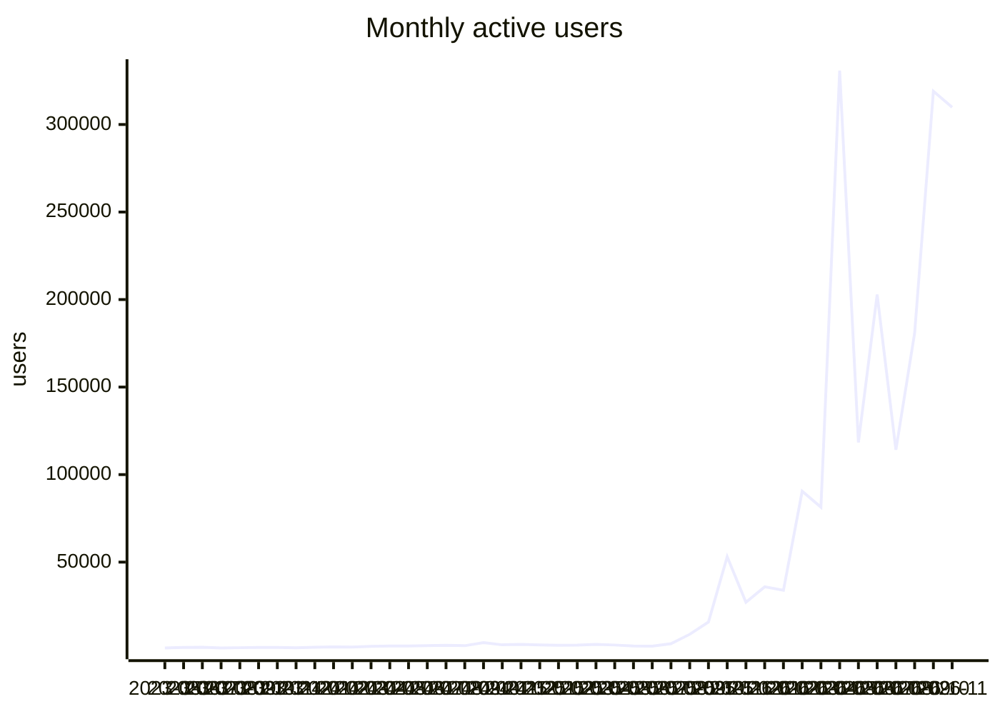

# VFB usage report

Generated 2026-11-15 from aggregate Google Analytics 4 counts for property 375054915, covering 2023-05-10 to 2026-11-14. Source tables: [`analytics/ga4/`](analytics/ga4/). Only summed counts are stored; nothing here identifies a user.

**Reading the numbers.** A large and growing share of 'users' and 'sessions' is automated traffic that loads one page and leaves within a second. Engaged hours (time with the page in the foreground) is barely touched by that traffic and is the most reliable measure of real use; seconds per session shows how bot-heavy a row is.

## Yearly totals

| year | peak monthly users | sessions | screenPageViews | engaged hours | sec/session |
|---|---|---|---|---|---|
| 2023 | 1,332 | 13,668 | 42,490 | 172.9 | 45.5 |
| 2024 | 4,045 | 62,091 | 465,976 | 1,046.3 | 60.7 |
| 2025 | 53,078 | 174,980 | 961,769 | 1,240.7 | 25.5 |
| 2026 | 330,801 | 1,910,362 | 4,963,298 | 4,573.2 | 8.6 |

## Monthly trend

| month | activeUsers | newUsers | sessions | screenPageViews | engaged hours | sec/session |
|---|---|---|---|---|---|---|
| 2024-12 | 2,996 | 2,325 | 6,433 | 42,248 | 80.3 | 45.0 |
| 2025-01 | 2,711 | 1,830 | 7,149 | 57,703 | 94.5 | 47.6 |
| 2025-02 | 2,483 | 1,473 | 6,460 | 69,682 | 130.5 | 72.7 |
| 2025-03 | 2,594 | 1,923 | 7,298 | 70,667 | 93.3 | 46.0 |
| 2025-04 | 2,961 | 2,158 | 5,752 | 46,050 | 107.5 | 67.3 |
| 2025-05 | 2,634 | 1,976 | 5,584 | 49,953 | 203.4 | 131.1 |
| 2025-06 | 2,044 | 1,803 | 5,615 | 39,033 | 60.9 | 39.0 |
| 2025-07 | 1,950 | 1,514 | 6,599 | 43,636 | 67.9 | 37.0 |
| 2025-08 | 3,396 | 3,134 | 8,653 | 67,983 | 113.5 | 47.2 |
| 2025-09 | 8,753 | 10,370 | 15,167 | 293,319 | 97.7 | 23.2 |
| 2025-10 | 15,773 | 15,259 | 19,431 | 62,052 | 89.3 | 16.5 |
| 2025-11 | 53,078 | 51,557 | 55,532 | 92,601 | 97.5 | 6.3 |
| 2025-12 | 27,089 | 26,632 | 30,314 | 69,090 | 84.8 | 10.1 |
| 2026-01 | 35,882 | 35,655 | 41,654 | 84,515 | 93.1 | 8.0 |
| 2026-02 | 33,896 | 33,815 | 38,136 | 81,618 | 89.5 | 8.5 |
| 2026-03 | 90,461 | 89,967 | 95,391 | 204,564 | 189.0 | 7.1 |
| 2026-04 | 81,384 | 81,647 | 85,778 | 152,209 | 110.6 | 4.6 |
| 2026-05 | 330,801 | 328,117 | 328,909 | 419,823 | 495.2 | 5.4 |
| 2026-06 | 118,372 | 120,130 | 125,861 | 215,401 | 120.8 | 3.5 |
| 2026-07 | 202,893 | 200,564 | 203,206 | 285,273 | 141.3 | 2.5 |
| 2026-08 | 114,152 | 116,038 | 121,133 | 261,249 | 223.3 | 6.6 |
| 2026-09 | 180,888 | 183,665 | 230,953 | 1,586,357 | 1,963.3 | 30.6 |
| 2026-10 | 319,023 | 302,918 | 333,450 | 996,586 | 813.6 | 8.8 |
| 2026-11 | 309,860 | 283,645 | 312,793 | 675,703 | 333.5 | 3.8 |

## By site, last 12 months

Page views with no host name are the v2 viewer's in-app term changes and are counted under the viewer.

| site | sessions | screenPageViews | engaged hours | sec/session |
|---|---|---|---|---|
| v2 viewer | 1,054,451 | 3,612,281 | 3,058.2 | 10.4 |
| www / docs | 993,017 | 1,096,944 | 1,107.3 | 4.0 |
| other VFB services | 202,853 | 223,226 | 508.2 | 9.0 |
| CATMAID | 39,038 | 38,912 | 44.7 | 4.1 |
| other / mirrors | 84,032 | 9,127 | 21.5 | 0.9 |
| legacy Edinburgh hosts | 143,982 | 144,469 | 15.7 | 0.4 |
| VFBchat | 26 | 30 | 0.0 | 0.4 |

## Countries, last 12 months

Ranked by engaged hours. 212 countries in total.

| country | users (sum of months) | sessions | engaged hours | sec/session |
|---|---|---|---|---|
| United States | 133,121 | 174,456 | 1,454.7 | 30.0 |
| United Kingdom | 18,197 | 28,937 | 729.0 | 90.7 |
| China | 448,301 | 452,509 | 268.5 | 2.1 |
| Germany | 15,999 | 23,730 | 201.2 | 30.5 |
| India | 15,404 | 18,580 | 195.0 | 37.8 |
| Puerto Rico | 247 | 1,603 | 148.6 | 333.8 |
| Hong Kong | 217,590 | 214,553 | 144.0 | 2.4 |
| Canada | 8,425 | 12,148 | 111.5 | 33.0 |
| Brazil | 22,684 | 24,337 | 85.9 | 12.7 |
| Australia | 4,508 | 6,738 | 78.6 | 42.0 |
| Russia | 6,658 | 8,663 | 74.8 | 31.1 |
| Singapore | 942,974 | 934,110 | 64.6 | 0.2 |
| Chile | 2,985 | 3,563 | 63.8 | 64.5 |
| Japan | 10,620 | 12,578 | 58.3 | 16.7 |
| Poland | 3,920 | 5,194 | 50.5 | 35.0 |
| France | 4,926 | 6,494 | 49.5 | 27.4 |
| Türkiye | 5,407 | 6,717 | 49.0 | 26.3 |
| Mexico | 7,514 | 8,350 | 47.3 | 20.4 |
| Spain | 3,487 | 4,607 | 44.8 | 35.0 |
| Italy | 2,825 | 3,553 | 39.5 | 40.1 |
| South Korea | 1,665 | 3,211 | 36.3 | 40.7 |
| Indonesia | 14,135 | 14,761 | 35.3 | 8.6 |
| Netherlands | 3,514 | 4,326 | 33.2 | 27.6 |
| Pakistan | 4,604 | 4,850 | 32.7 | 24.3 |
| Philippines | 5,460 | 5,858 | 29.8 | 18.3 |
| New Zealand | 817 | 1,062 | 26.8 | 91.0 |
| (not set) | 1,042 | 998 | 26.4 | 95.3 |
| Argentina | 5,786 | 6,250 | 26.4 | 15.2 |
| Thailand | 2,738 | 3,279 | 24.2 | 26.6 |
| Israel | 1,700 | 2,400 | 23.8 | 35.7 |

## Cities, last 12 months

GA4 has no institution or network dimension, so city is the nearest proxy for where labs are. Cities with fewer than 5 users in a month are not stored. Data-centre cities (Ashburn, Council Bluffs, Singapore and similar) show up with near-zero seconds per session.

| city | country | months seen | sessions | engaged hours | sec/session |
|---|---|---|---|---|---|
| Dunblane | United Kingdom | 1 | 84 | 361.1 | 15,475.0 |
| Hong Kong | Hong Kong | 13 | 215,388 | 141.0 | 2.4 |
| Singapore | Singapore | 13 | 862,715 | 52.6 | 0.2 |
| San Juan | Puerto Rico | 7 | 702 | 51.9 | 266.2 |
| Kashgar Prefecture | China | 3 | 98,655 | 50.0 | 1.8 |
| Santiago | Chile | 12 | 1,869 | 48.3 | 92.9 |
| London | United Kingdom | 13 | 5,290 | 46.0 | 31.3 |
| New York | United States | 13 | 4,767 | 38.3 | 28.9 |
| Urumqi | China | 5 | 76,163 | 30.9 | 1.5 |
| Los Angeles | United States | 13 | 3,222 | 30.6 | 34.2 |
| Chicago | United States | 13 | 5,446 | 27.1 | 17.9 |
| Frederick | United States | 1 | 17 | 24.7 | 5,235.5 |
| Moscow | Russia | 11 | 2,506 | 24.7 | 35.5 |
| Munich | Germany | 11 | 510 | 24.1 | 170.1 |
| Bengaluru | India | 11 | 1,997 | 24.0 | 43.3 |
| Beijing | China | 13 | 11,699 | 23.4 | 7.2 |
| Karachi | Pakistan | 10 | 983 | 21.9 | 80.4 |
| Round Rock | United States | 2 | 50 | 21.2 | 1,525.3 |
| Athens | United States | 5 | 447 | 21.2 | 170.4 |
| San Jose | United States | 13 | 5,302 | 20.9 | 14.2 |
| Phoenix | United States | 9 | 4,886 | 20.8 | 15.3 |
| Edinburgh | United Kingdom | 10 | 490 | 19.7 | 144.5 |
| Cambridge | United Kingdom | 13 | 1,863 | 19.1 | 37.0 |
| Auckland | New Zealand | 8 | 463 | 18.9 | 146.8 |
| Sydney | Australia | 10 | 1,948 | 18.4 | 34.1 |
| Istanbul | Türkiye | 12 | 2,282 | 18.2 | 28.7 |
| Cologne | Germany | 11 | 765 | 17.7 | 83.4 |
| Flint Hill | United States | 7 | 5,439 | 17.7 | 11.7 |
| Melbourne | Australia | 9 | 1,515 | 17.0 | 40.4 |
| Houston | United States | 13 | 2,102 | 16.4 | 28.1 |
| Miami | United States | 11 | 796 | 16.0 | 72.2 |
| Dallas | United States | 13 | 1,927 | 15.8 | 29.5 |
| Atlanta | United States | 13 | 1,240 | 15.5 | 45.0 |
| Toronto | Canada | 13 | 1,744 | 15.5 | 31.9 |
| Boston | United States | 13 | 2,000 | 15.1 | 27.3 |
| Brisbane | Australia | 9 | 1,114 | 14.3 | 46.4 |
| Warsaw | Poland | 13 | 1,659 | 13.9 | 30.1 |
| Harbin | China | 5 | 7,617 | 13.1 | 6.2 |
| Berlin | Germany | 13 | 1,090 | 12.3 | 40.8 |
| Seattle | United States | 12 | 1,408 | 11.8 | 30.2 |
| Paris | France | 13 | 1,168 | 11.7 | 35.9 |
| Shanghai | China | 13 | 7,673 | 11.6 | 5.4 |
| Seoul | South Korea | 13 | 1,103 | 11.5 | 37.6 |
| Des Moines | United States | 11 | 3,928 | 11.1 | 10.1 |
| Philadelphia | United States | 13 | 1,364 | 10.9 | 28.7 |
| Bangkok | Thailand | 9 | 1,409 | 10.9 | 27.8 |
| Rostock | Germany | 2 | 144 | 10.7 | 268.7 |
| Shenzhen | China | 13 | 1,831 | 10.6 | 20.8 |
| Ashburn | United States | 13 | 7,045 | 10.4 | 5.3 |
| Mumbai | India | 12 | 1,004 | 10.3 | 37.0 |

## Most viewed terms

Taken from the term id in viewer URLs and `/reports/` and `/term/` pages. The adult brain template leads because it is the default scene, not because people search for it.

### Last 30 days

| term | label | views | engaged hours | days seen |
|---|---|---|---|---|
| VFB_00101567 | JRC2018Unisex | 366,242 | 118.9 | 30 |
| FBbt_00003624 | adult brain | 18,438 | 5.8 | 30 |
| VFB_00108w0p | BANC:brain_neuropil on JRC2018Unisex | 8,996 | 3.4 | 30 |
| FBbt_00003748 | medulla | 8,994 | 3.2 | 30 |
| FBbt_00003681 | adult lateral accessory lobe | 7,031 | 1.6 | 30 |
| FBbt_00005093 | nervous system | 6,064 | 1.5 | 30 |
| VFBexp_FBtp0104 |  | 5,969 | 0.9 | 29 |
| VFBexp_FBtp0101 |  | 5,702 | 0.8 | 30 |
| VFBexp_FBtp0103 |  | 5,698 | 0.9 | 30 |
| VFBexp_FBtp0105 |  | 5,697 | 0.9 | 29 |
| VFBexp_FBtp0121 |  | 5,424 | 0.6 | 30 |
| VFBexp_FBtp0100 |  | 5,406 | 0.8 | 29 |
| VFBexp_FBtp0122 |  | 5,397 | 0.8 | 29 |
| VFBexp_FBtp0106 |  | 5,306 | 0.8 | 30 |
| VFBexp_FBtp0102 |  | 5,286 | 0.8 | 30 |
| FBbt_00040041 | vest | 5,208 | 1.3 | 30 |
| FBbt_00040043 | anterior ventrolateral protocerebrum | 5,113 | 1.6 | 30 |
| VFBexp_FBtp0107 |  | 4,942 | 0.8 | 30 |
| FBbt_00045048 | saddle | 4,661 | 49.0 | 30 |
| VFBexp_FBtp0123 |  | 4,288 | 0.7 | 30 |
| FBbt_00003004 | adult | 3,983 | 1.3 | 30 |
| VFBexp_FBtp0124 |  | 3,979 | 0.6 | 30 |
| FBbt_00047887 | adult central brain | 3,634 | 0.6 | 30 |
| VFBexp_FBtp0099 |  | 3,566 | 0.5 | 30 |
| FBbt_00040042 | posterior ventrolateral protocerebrum | 3,300 | 1.0 | 30 |

### Last 12 months

| term | label | views | engaged hours | days seen |
|---|---|---|---|---|
| VFB_00101567 | JRC2018Unisex | 1,133,349 | 1,701.4 | 365 |
| FBbt_00003624 | adult brain | 94,458 | 50.4 | 336 |
| FBbt_00003748 | medulla | 71,361 | 40.0 | 346 |
| FBbt_00003681 | adult lateral accessory lobe | 57,790 | 28.5 | 343 |
| FBbt_00040041 | vest | 48,226 | 22.9 | 330 |
| FBbt_00005093 | nervous system | 42,790 | 20.1 | 312 |
| FBbt_00040043 | anterior ventrolateral protocerebrum | 40,634 | 19.6 | 308 |
| FBbt_00045048 | saddle | 38,999 | 64.1 | 310 |
| FBbt_00003004 | adult | 36,355 | 16.8 | 296 |
| FBbt_00003680 | nodulus | 34,706 | 7.9 | 257 |
| FBbt_00047887 | adult central brain | 29,613 | 9.6 | 289 |
| FBbt_00040042 | posterior ventrolateral protocerebrum | 27,801 | 12.5 | 296 |
| VFB_00108w0p | BANC:brain_neuropil on JRC2018Unisex | 24,091 | 9.5 | 69 |
| FBbt_00003678 | ellipsoid body | 22,409 | 12.7 | 296 |
| VFB_jrchk7yg | WEDPN2A_R (FlyEM-HB:885788485) | 22,052 | 6.0 | 177 |
| FBbt_00014013 | adult gnathal ganglion | 21,474 | 12.6 | 281 |
| FBbt_00045027 | wedge | 20,939 | 9.0 | 286 |
| VFB_00050000 | L1 larval CNS ssTEM - Cardona/Janelia | 18,407 | 32.0 | 326 |
| FBbt_00007050 | adult cerebrum | 17,735 | 6.3 | 270 |
| VFB_00102107 | ME on JRC2018Unisex adult brain | 16,887 | 11.2 | 255 |
| FBbt_00045050 | flange | 15,151 | 6.5 | 251 |
| FBbt_00003632 | adult central complex | 14,362 | 5.1 | 219 |
| FBbt_00110636 | adult cerebral ganglion | 14,062 | 5.3 | 260 |
| FBbt_00053384 | adult primary visual center | 14,011 | 6.1 | 221 |
| FBbt_00003679 | fan-shaped body | 13,637 | 6.4 | 269 |

### All time

| term | label | views | engaged hours | days seen |
|---|---|---|---|---|
| VFB_00101567 | JRC2018Unisex | 1,337,267 | 1,946.9 | 1,004 |
| FBbt_00003624 | adult brain | 107,834 | 74.0 | 891 |
| FBbt_00003748 | medulla | 81,355 | 61.0 | 882 |
| FBbt_00003681 | adult lateral accessory lobe | 64,381 | 42.8 | 854 |
| FBbt_00040041 | vest | 54,572 | 34.5 | 826 |
| FBbt_00040043 | anterior ventrolateral protocerebrum | 45,947 | 29.9 | 749 |
| FBbt_00005093 | nervous system | 44,474 | 22.8 | 462 |
| FBbt_00045048 | saddle | 43,437 | 73.1 | 760 |
| FBbt_00003004 | adult | 38,814 | 19.5 | 502 |
| FBbt_00003680 | nodulus | 36,565 | 12.1 | 555 |
| FBbt_00047887 | adult central brain | 34,240 | 16.1 | 676 |
| FBbt_00040042 | posterior ventrolateral protocerebrum | 31,142 | 20.0 | 702 |
| VFB_00050000 | L1 larval CNS ssTEM - Cardona/Janelia | 26,408 | 45.2 | 822 |
| FBbt_00003678 | ellipsoid body | 25,706 | 19.6 | 661 |
| FBbt_00014013 | adult gnathal ganglion | 25,212 | 21.2 | 661 |
| VFB_00108w0p | BANC:brain_neuropil on JRC2018Unisex | 24,091 | 9.5 | 69 |
| FBbt_00045027 | wedge | 23,648 | 15.0 | 657 |
| VFB_jrchk7yg | WEDPN2A_R (FlyEM-HB:885788485) | 22,223 | 6.7 | 190 |
| VFB_00102107 | ME on JRC2018Unisex adult brain | 20,796 | 16.1 | 550 |
| FBbt_00007050 | adult cerebrum | 20,663 | 10.6 | 575 |
| FBbt_00003679 | fan-shaped body | 19,095 | 12.8 | 617 |
| VFB_00030867 | adult mushroom body on adult brain template JFRC2 | 17,507 | 13.1 | 454 |
| FBbt_00045050 | flange | 17,236 | 11.1 | 556 |
| FBbt_00110636 | adult cerebral ganglion | 16,620 | 8.5 | 561 |
| FBbt_00003632 | adult central complex | 16,286 | 8.8 | 429 |

### Templates in use, last 12 months

| template | label | views |
|---|---|---|
| VFB_00101567 | JRC2018Unisex | 1,726,717 |
| VFB_00050000 | L1 larval CNS ssTEM - Cardona/Janelia | 37,237 |
| VFB_00200000 | JRC2018UnisexVNC | 22,290 |
| VFB_00017894 | adult brain template JFRC2 | 19,809 |
| VFB_00049000 | L3 CNS template - Wood2018 | 10,231 |
| VFB_00101384 | JRC_FlyEM_Hemibrain | 5,887 |
| VFB_00110000 | Adult Head (McKellar2020) | 3,424 |
| VFB_00120000 | Adult T1 Leg (Kuan2020) | 2,217 |
| FBbt_00003624 | adult brain | 1,385 |
| VFB_00100000 | adult VNS template - Court2018 | 1,307 |

## Website and documentation pages, last 12 months

| pagePath | screenPageViews | engaged hours |
|---|---|---|
| / | 226,148 | 647.0 |
| /docs/ | 20,379 | 47.3 |
| /about/ | 6,715 | 29.5 |
| /docs/overview/ | 4,385 | 24.8 |
| /blog/releases/catmaid/ | 547 | 22.4 |
| /docs/data/ | 6,740 | 22.1 |
| /docs/tutorials/vfb-mcp-guide/ | 1,978 | 11.2 |
| /docs/website-features/3dviewer/ | 2,938 | 10.7 |
| /docs/tutorials/ | 2,797 | 6.6 |
| /hosted/ | 3,159 | 6.6 |
| /docs/contribution-guidelines/ | 1,461 | 5.8 |
| /about/whichfly/ | 545 | 5.5 |
| /docs/website-features/search_query/ | 900 | 4.0 |
| /blog/news/ | 1,713 | 3.8 |
| /docs/tutorials/apis/ | 825 | 3.8 |
| /docs/apis/ | 783 | 3.8 |
| /docs/concepts/flylight_tiles/ | 643 | 3.7 |
| /blog/2026/09/06/vfb-self-led-learning-sessions-a-free-online-workshop-open-to-everyone/ | 1,189 | 3.4 |
| /docs/website-features/ | 1,233 | 3.2 |
| /docs/concepts/ | 600 | 2.8 |
| /docs/data/em/ | 534 | 2.6 |
| /docs/concepts/neuron-counts/ | 330 | 2.6 |
| /docs/tutorials/apis/vfb_api_overview/ | 385 | 2.4 |
| /docs/website-features/download/ | 636 | 2.4 |
| /docs/concepts/cell_types/ | 391 | 2.4 |
| /docs/tutorials/website/similarityscore/ | 358 | 2.3 |
| /docs/tutorials/website/bulkdownloads/ | 579 | 2.3 |
| /about/hosted/ | 934 | 2.3 |
| /docs/tools/ | 438 | 2.2 |
| /about/whatisvfb/ | 662 | 2.1 |

## How people arrive

Engaged sessions by channel and year.

| channel | 2023 | 2024 | 2025 | 2026 |
|---|---|---|---|---|
| AI Assistant | 0 | 0 | 0 | 2,593 |
| Cross-network | 0 | 0 | 0 | 3 |
| Direct | 1,628 | 10,737 | 124,445 | 1,640,851 |
| Organic Search | 3,198 | 18,605 | 30,520 | 201,092 |
| Organic Shopping | 0 | 3 | 2 | 0 |
| Organic Social | 7 | 454 | 125 | 1,447 |
| Organic Video | 0 | 2 | 0 | 143 |
| Referral | 495 | 18,973 | 11,071 | 10,307 |
| Unassigned | 0 | 6 | 60 | 1,562 |

Top sources, last 12 months.

| sessionSource | sessions | engaged hours |
|---|---|---|
| google | 192,003 | 2,509.3 |
| (direct) | 1,691,293 | 1,471.7 |
| bing | 14,250 | 295.5 |
| (not set) | 45,412 | 80.8 |
| chatgpt.com | 2,817 | 38.8 |
| yahoo | 867 | 32.8 |
| duckduckgo | 2,796 | 31.9 |
| cn.bing.com | 816 | 28.5 |
| splitgal4.janelia.org | 1,554 | 14.6 |
| codex.flywire.ai | 1,667 | 14.0 |
| gemini.google.com | 587 | 13.9 |
| flybase.org | 923 | 13.6 |
| ecosia.org | 797 | 9.8 |
| github.com | 647 | 9.4 |
| moodle.carleton.edu | 120 | 6.3 |
| trafficheap.com | 502 | 5.8 |
| trafficheap.cc | 502 | 5.8 |
| en.wikipedia.org | 340 | 5.5 |
| science.org | 147 | 5.3 |
| janelia.org | 171 | 5.1 |
| search.brave.com | 315 | 5.0 |
| yandex.ru | 252 | 4.0 |
| neuronbridge.janelia.org | 87 | 3.8 |
| translate.google.com | 222 | 3.6 |
| cell.com | 223 | 3.5 |

## Queries run in the viewer, last 12 months

| query | runs |
|---|---|
| neuronneuronconnectivit | 10,534 |
| neuronregionconnectivit | 8,141 |
| similarmorphologyto | 6,743 |
| listallavailableimages | 5,702 |
| allalignedimages | 5,487 |
| findstocks | 4,080 |
| anatomyexpressedin | 3,650 |
| imagesneurons | 2,834 |
| epfrag | 1,721 |
| similarmorphologytonb | 1,292 |
| neuronsparthere | 1,092 |
| upstreamclassconnectivi | 999 |
| downstreamclassconnecti | 998 |
| alldatasets | 960 |
| aligneddatasets | 929 |
| similarmorphologytopart | 751 |
| partsof | 688 |
| subclassesof | 513 |
| painteddomains | 408 |
| neuronssynaptic | 333 |
| transgeneexpressionhere | 324 |
| targetneurons | 274 |
| neuronspostsynaptichere | 246 |
| neuronspresynaptichere | 224 |
| datasetimages | 166 |

## VFBchat and MCP

| month | chat_query | mcp_tool_call |
|---|---|---|
| 2026-02 | 70 | 492 |
| 2026-03 | 354 | 2,258 |
| 2026-04 | 575 | 7,992 |
| 2026-05 | 17 | 971 |
| 2026-06 | 358 | 30,858 |
| 2026-07 | 9 | 18,938 |
| 2026-08 | 1,017 | 89,583 |
| 2026-09 | 797 | 84,835 |
| 2026-10 | 224 | 28,191 |
| 2026-11 | 36 | 14,533 |

## Viewer reliability

| month | session_start | disconnected | reconnected-resumed | reconnect-failed-reloading | reconnect-exhausted | disconnects per 100 sessions |
|---|---|---|---|---|---|---|
| 2025-06 | 3,466 | 1,365 | 0 | 12 | 0 | 39.4 |
| 2025-07 | 4,662 | 2,057 | 0 | 18 | 0 | 44.1 |
| 2025-08 | 6,571 | 1,680 | 0 | 17 | 0 | 25.6 |
| 2025-09 | 6,265 | 1,170 | 0 | 24 | 0 | 18.7 |
| 2025-10 | 7,777 | 1,232 | 0 | 17 | 0 | 15.8 |
| 2025-11 | 8,460 | 1,163 | 0 | 24 | 0 | 13.7 |
| 2025-12 | 10,434 | 1,359 | 0 | 8 | 0 | 13.0 |
| 2026-01 | 21,913 | 1,530 | 0 | 30 | 0 | 7.0 |
| 2026-02 | 24,790 | 1,536 | 0 | 31 | 0 | 6.2 |
| 2026-03 | 23,808 | 5,059 | 0 | 465 | 0 | 21.2 |
| 2026-04 | 23,996 | 2,933 | 0 | 33 | 0 | 12.2 |
| 2026-05 | 55,407 | 2,314 | 0 | 44 | 0 | 4.2 |
| 2026-06 | 23,505 | 2,149 | 0 | 158 | 0 | 9.1 |
| 2026-07 | 45,208 | 2,280 | 0 | 49 | 0 | 5.0 |
| 2026-08 | 24,841 | 3,675 | 0 | 530 | 0 | 14.8 |
| 2026-09 | 51,588 | 75,199 | 30,436 | 38,791 | 1,919 | 145.8 |
| 2026-10 | 142,443 | 15,122 | 6,573 | 7,432 | 588 | 10.6 |
| 2026-11 | 132,933 | 18 | 0 | 0 | 3 | 0.0 |

Load times from the timing suffix on viewer events (months with at least 100 samples).

| month | event | n | median s | p95 s |
|---|---|---|---|---|
| 2026-09 | direct-geom:obj:ok | 61,923 | 1.4 | 25.4 |
| 2026-10 | direct-geom:obj:ok | 107,017 | 3.7 | 8.1 |
| 2026-11 | direct-geom:obj:ok | 69,960 | 3.7 | 6.5 |
| 2026-09 | direct-terminfo:ok | 109,210 | 0.4 | 3.0 |
| 2026-10 | direct-terminfo:ok | 271,878 | 0.7 | 2.4 |
| 2026-11 | direct-terminfo:ok | 156,399 | 0.8 | 5.3 |
| 2026-09 | startup-first-term | 50,164 | 5.2 | 58.0 |
| 2026-10 | startup-first-term | 100,642 | 6.1 | 16.0 |
| 2026-11 | startup-first-term | 71,949 | 6.1 | 14.0 |
| 2026-09 | startup-model | 54,086 | 2.8 | 25.0 |
| 2026-10 | startup-model | 158,414 | 1.3 | 5.2 |
| 2026-11 | startup-model | 130,130 | 1.3 | 3.1 |
| 2026-09 | term-load:ok | 104,726 | 1.0 | 45.0 |
| 2026-10 | term-load:ok | 167,247 | 3.9 | 11.0 |
| 2026-11 | term-load:ok | 93,181 | 4.6 | 12.0 |

## Outbound links clicked, last 12 months

| linkDomain | clicks |
|---|---|
| virtualflybrain.org | 1,567 |
| neuronbridge.janelia.org | 1,436 |
| pypi.org | 1,398 |
| github.com | 968 |
| v2.virtualflybrain.org | 701 |
| insectbraindb.org | 659 |
| flweb.janelia.org | 442 |
| colab.research.google.com | 412 |
| translate.google.com | 391 |
| doi.org | 360 |
| flybase.org | 213 |
| chat.virtualflybrain.org | 100 |
| virtualflybrain.bsky.social | 88 |
| codex.flywire.ai | 86 |
| vfb3-mcp.virtualflybrain.org | 59 |
| google.com | 57 |
| neurofly.org | 51 |
| neuprint.janelia.org | 49 |
| janelia.org | 48 |
| zenodo.org | 32 |

## Devices and browsers, last 12 months

| deviceCategory | browser | sessions | engaged hours |
|---|---|---|---|
| desktop | Chrome | 1,805,981 | 3,002.4 |
| desktop | Edge | 22,358 | 468.6 |
| mobile | Chrome | 48,812 | 354.9 |
| desktop | Safari | 15,521 | 211.7 |
| desktop | Firefox | 11,810 | 207.0 |
| desktop | Opera | 14,472 | 177.4 |
| mobile | Safari | 34,781 | 166.3 |
| tablet | Chrome | 2,916 | 38.4 |
| tablet | Safari | 1,054 | 12.9 |
| mobile | Samsung Internet | 1,601 | 11.3 |
| mobile | Firefox | 1,282 | 11.2 |
| desktop | YaBrowser | 525 | 7.9 |

## What this data cannot show

- **Institutions.** GA4 dropped the network-domain dimension and never exposes IP addresses. City is as close as it gets.
- **Search terms typed into VFB.** The viewer does not send a `search` event, so `searchTerm` is empty. Term popularity above comes from term ids in URLs.
- **Event detail.** No custom dimensions are registered on the property, so event parameters (`event_label`, `event_category`, and the VFBchat and MCP parameters such as tool name and topic) are discarded from reports. Registration is not retroactive.
- **Yearly unique users.** Users do not add up across days or months; only daily and monthly uniques are stored.
