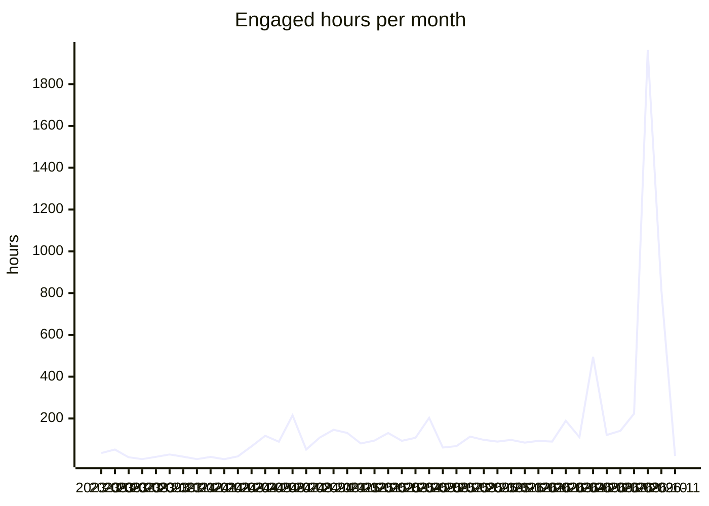

# VFB usage report

Generated 2026-11-02 from aggregate Google Analytics 4 counts for property 375054915, covering 2023-05-10 to 2026-11-01. Source tables: [`analytics/ga4/`](analytics/ga4/). Only summed counts are stored; nothing here identifies a user.

**Reading the numbers.** A large and growing share of 'users' and 'sessions' is automated traffic that loads one page and leaves within a second. Engaged hours (time with the page in the foreground) is barely touched by that traffic and is the most reliable measure of real use; seconds per session shows how bot-heavy a row is.

## Yearly totals

| year | peak monthly users | sessions | screenPageViews | engaged hours | sec/session |
|---|---|---|---|---|---|
| 2023 | 1,332 | 13,668 | 42,490 | 172.9 | 45.5 |
| 2024 | 4,045 | 62,091 | 465,976 | 1,046.3 | 60.7 |
| 2025 | 53,078 | 174,980 | 961,769 | 1,240.7 | 25.5 |
| 2026 | 330,801 | 1,612,661 | 4,321,799 | 4,260.4 | 9.5 |

## Monthly trend

| month | activeUsers | newUsers | sessions | screenPageViews | engaged hours | sec/session |
|---|---|---|---|---|---|---|
| 2024-12 | 2,996 | 2,325 | 6,433 | 42,248 | 80.3 | 45.0 |
| 2025-01 | 2,711 | 1,830 | 7,149 | 57,703 | 94.5 | 47.6 |
| 2025-02 | 2,483 | 1,473 | 6,460 | 69,682 | 130.5 | 72.7 |
| 2025-03 | 2,594 | 1,923 | 7,298 | 70,667 | 93.3 | 46.0 |
| 2025-04 | 2,961 | 2,158 | 5,752 | 46,050 | 107.5 | 67.3 |
| 2025-05 | 2,634 | 1,976 | 5,584 | 49,953 | 203.4 | 131.1 |
| 2025-06 | 2,044 | 1,803 | 5,615 | 39,033 | 60.9 | 39.0 |
| 2025-07 | 1,950 | 1,514 | 6,599 | 43,636 | 67.9 | 37.0 |
| 2025-08 | 3,396 | 3,134 | 8,653 | 67,983 | 113.5 | 47.2 |
| 2025-09 | 8,753 | 10,370 | 15,167 | 293,319 | 97.7 | 23.2 |
| 2025-10 | 15,773 | 15,259 | 19,431 | 62,052 | 89.3 | 16.5 |
| 2025-11 | 53,078 | 51,557 | 55,532 | 92,601 | 97.5 | 6.3 |
| 2025-12 | 27,089 | 26,632 | 30,314 | 69,090 | 84.8 | 10.1 |
| 2026-01 | 35,882 | 35,655 | 41,654 | 84,515 | 93.1 | 8.0 |
| 2026-02 | 33,896 | 33,815 | 38,136 | 81,618 | 89.5 | 8.5 |
| 2026-03 | 90,461 | 89,967 | 95,391 | 204,564 | 189.0 | 7.1 |
| 2026-04 | 81,384 | 81,647 | 85,778 | 152,209 | 110.6 | 4.6 |
| 2026-05 | 330,801 | 328,117 | 328,909 | 419,823 | 495.2 | 5.4 |
| 2026-06 | 118,372 | 120,130 | 125,861 | 215,401 | 120.8 | 3.5 |
| 2026-07 | 202,893 | 200,564 | 203,206 | 285,273 | 141.3 | 2.5 |
| 2026-08 | 114,152 | 116,038 | 121,133 | 261,249 | 223.3 | 6.6 |
| 2026-09 | 180,888 | 183,665 | 230,953 | 1,586,357 | 1,963.3 | 30.6 |
| 2026-10 | 319,023 | 302,918 | 333,450 | 996,586 | 813.6 | 8.8 |
| 2026-11 | 12,359 | 10,417 | 12,571 | 34,204 | 20.6 | 5.9 |

## By site, last 12 months

Page views with no host name are the v2 viewer's in-app term changes and are counted under the viewer.

| site | sessions | screenPageViews | engaged hours | sec/session |
|---|---|---|---|---|
| v2 viewer | 808,172 | 3,136,763 | 2,853.5 | 12.7 |
| www / docs | 859,326 | 958,693 | 1,053.9 | 4.4 |
| other VFB services | 187,188 | 198,759 | 455.7 | 8.8 |
| CATMAID | 38,582 | 38,443 | 43.4 | 4.0 |
| other / mirrors | 83,863 | 8,861 | 20.6 | 0.9 |
| legacy Edinburgh hosts | 141,460 | 141,941 | 15.6 | 0.4 |
| VFBchat | 26 | 30 | 0.0 | 0.4 |

## Countries, last 12 months

Ranked by engaged hours. 212 countries in total.

| country | users (sum of months) | sessions | engaged hours | sec/session |
|---|---|---|---|---|
| United States | 120,983 | 161,381 | 1,378.5 | 30.8 |
| United Kingdom | 17,086 | 27,584 | 716.7 | 93.5 |
| Germany | 14,776 | 22,338 | 191.6 | 30.9 |
| India | 14,977 | 18,066 | 189.6 | 37.8 |
| China | 288,513 | 291,718 | 175.9 | 2.2 |
| Puerto Rico | 237 | 1,593 | 148.6 | 335.7 |
| Canada | 7,937 | 11,574 | 106.7 | 33.2 |
| Hong Kong | 130,764 | 130,416 | 100.8 | 2.8 |
| Brazil | 20,347 | 21,966 | 83.4 | 13.7 |
| Australia | 4,250 | 6,356 | 73.9 | 41.8 |
| Russia | 6,290 | 8,192 | 73.5 | 32.3 |
| Chile | 2,716 | 3,280 | 61.3 | 67.3 |
| Singapore | 872,103 | 865,223 | 59.7 | 0.2 |
| Japan | 9,859 | 11,789 | 56.3 | 17.2 |
| Poland | 3,753 | 4,945 | 48.1 | 35.0 |
| France | 4,450 | 5,964 | 47.6 | 28.8 |
| Türkiye | 5,255 | 6,551 | 47.6 | 26.2 |
| Mexico | 6,879 | 7,685 | 46.0 | 21.6 |
| Spain | 3,183 | 4,276 | 42.6 | 35.9 |
| Italy | 2,658 | 3,363 | 38.5 | 41.2 |
| Indonesia | 13,241 | 13,846 | 33.6 | 8.7 |
| South Korea | 1,607 | 3,109 | 33.4 | 38.6 |
| Pakistan | 4,323 | 4,561 | 32.2 | 25.4 |
| Netherlands | 3,310 | 4,086 | 31.1 | 27.4 |
| Philippines | 5,180 | 5,554 | 28.7 | 18.6 |
| (not set) | 1,029 | 986 | 26.4 | 96.4 |
| Argentina | 5,099 | 5,551 | 25.5 | 16.6 |
| Thailand | 2,470 | 2,995 | 23.2 | 27.9 |
| Israel | 1,597 | 2,272 | 23.2 | 36.8 |
| Taiwan | 952 | 1,622 | 21.7 | 48.1 |

## Cities, last 12 months

GA4 has no institution or network dimension, so city is the nearest proxy for where labs are. Cities with fewer than 5 users in a month are not stored. Data-centre cities (Ashburn, Council Bluffs, Singapore and similar) show up with near-zero seconds per session.

| city | country | months seen | sessions | engaged hours | sec/session |
|---|---|---|---|---|---|
| Dunblane | United Kingdom | 1 | 84 | 361.1 | 15,475.0 |
| Hong Kong | Hong Kong | 13 | 129,045 | 97.9 | 2.7 |
| San Juan | Puerto Rico | 7 | 702 | 51.9 | 266.2 |
| Singapore | Singapore | 13 | 844,769 | 51.2 | 0.2 |
| Santiago | Chile | 11 | 1,736 | 46.3 | 96.0 |
| London | United Kingdom | 13 | 5,038 | 44.1 | 31.5 |
| New York | United States | 13 | 4,404 | 36.5 | 29.9 |
| Los Angeles | United States | 13 | 3,060 | 28.7 | 33.8 |
| Chicago | United States | 12 | 5,276 | 26.6 | 18.1 |
| Urumqi | China | 5 | 66,335 | 25.7 | 1.4 |
| Frederick | United States | 1 | 17 | 24.7 | 5,235.5 |
| Moscow | Russia | 10 | 2,406 | 24.3 | 36.3 |
| Munich | Germany | 10 | 477 | 23.9 | 180.6 |
| Bengaluru | India | 11 | 1,944 | 23.6 | 43.7 |
| Karachi | Pakistan | 9 | 925 | 21.4 | 83.2 |
| Round Rock | United States | 2 | 50 | 21.2 | 1,525.3 |
| San Jose | United States | 13 | 5,066 | 20.0 | 14.2 |
| Phoenix | United States | 8 | 4,553 | 19.6 | 15.5 |
| Cambridge | United Kingdom | 12 | 1,847 | 18.9 | 36.8 |
| Edinburgh | United Kingdom | 9 | 456 | 18.9 | 149.2 |
| Istanbul | Türkiye | 11 | 2,221 | 17.8 | 28.8 |
| Sydney | Australia | 9 | 1,860 | 17.5 | 33.9 |
| Athens | United States | 4 | 386 | 16.9 | 157.4 |
| Flint Hill | United States | 6 | 5,147 | 16.7 | 11.7 |
| Melbourne | Australia | 9 | 1,423 | 16.2 | 40.9 |
| Cologne | Germany | 10 | 730 | 15.9 | 78.3 |
| Miami | United States | 10 | 737 | 15.8 | 77.4 |
| Houston | United States | 13 | 2,011 | 15.7 | 28.1 |
| Dallas | United States | 12 | 1,852 | 15.3 | 29.7 |
| Toronto | Canada | 12 | 1,658 | 15.1 | 32.7 |
| Boston | United States | 12 | 1,955 | 15.0 | 27.7 |
| Atlanta | United States | 12 | 1,163 | 14.7 | 45.7 |
| Beijing | China | 13 | 4,585 | 13.8 | 10.9 |
| Brisbane | Australia | 9 | 1,013 | 13.6 | 48.4 |
| Warsaw | Poland | 13 | 1,593 | 13.4 | 30.3 |
| Berlin | Germany | 12 | 1,033 | 12.0 | 42.0 |
| Paris | France | 12 | 1,117 | 11.4 | 36.9 |
| Shanghai | China | 12 | 7,594 | 11.4 | 5.4 |
| Seoul | South Korea | 12 | 1,076 | 11.2 | 37.6 |
| Seattle | United States | 12 | 1,343 | 10.8 | 29.1 |
| Rostock | Germany | 2 | 144 | 10.7 | 268.7 |
| Shenzhen | China | 12 | 1,793 | 10.5 | 21.0 |
| Philadelphia | United States | 13 | 1,259 | 10.4 | 29.9 |
| Bangkok | Thailand | 8 | 1,306 | 10.4 | 28.6 |
| Des Moines | United States | 10 | 3,594 | 10.2 | 10.2 |
| Mumbai | India | 11 | 969 | 10.0 | 37.1 |
| Ashburn | United States | 13 | 5,322 | 9.7 | 6.6 |
| Mexico City | Mexico | 11 | 1,453 | 9.6 | 23.8 |
| Sao Paulo | Brazil | 10 | 1,920 | 9.5 | 17.7 |
| San Francisco | United States | 10 | 1,401 | 9.5 | 24.4 |

## Most viewed terms

Taken from the term id in viewer URLs and `/reports/` and `/term/` pages. The adult brain template leads because it is the default scene, not because people search for it.

### Last 30 days

| term | label | views | engaged hours | days seen |
|---|---|---|---|---|
| VFB_00101567 | JRC2018Unisex | 241,640 | 221.3 | 30 |
| FBbt_00003624 | adult brain | 26,738 | 11.9 | 30 |
| FBbt_00003748 | medulla | 12,569 | 4.6 | 30 |
| FBbt_00003681 | adult lateral accessory lobe | 9,948 | 3.3 | 30 |
| FBbt_00005093 | nervous system | 8,259 | 2.8 | 30 |
| VFB_00108w0p | BANC:brain_neuropil on JRC2018Unisex | 7,942 | 3.3 | 30 |
| FBbt_00040041 | vest | 7,642 | 2.1 | 30 |
| FBbt_00040043 | anterior ventrolateral protocerebrum | 6,563 | 2.3 | 30 |
| FBbt_00045048 | saddle | 6,520 | 50.0 | 30 |
| FBbt_00007146 | adult deutocerebrum | 6,028 | 0.1 | 29 |
| FBbt_00003680 | nodulus | 5,929 | 0.9 | 30 |
| FBbt_00003004 | adult | 5,572 | 2.1 | 30 |
| FBbt_00047887 | adult central brain | 4,906 | 1.2 | 30 |
| FBbt_00040042 | posterior ventrolateral protocerebrum | 4,511 | 1.7 | 30 |
| VFBexp_FBtp0121 |  | 4,007 | 0.4 | 28 |
| VFBexp_FBtp0122 |  | 3,821 | 0.6 | 25 |
| FBbt_00045027 | wedge | 3,702 | 1.1 | 30 |
| VFBexp_FBtp0104 |  | 3,691 | 0.3 | 21 |
| FBbt_00003678 | ellipsoid body | 3,670 | 1.3 | 30 |
| VFBexp_FBtp0103 |  | 3,636 | 0.5 | 21 |
| VFBexp_FBtp0101 |  | 3,505 | 0.4 | 21 |
| VFBexp_FBtp0105 |  | 3,471 | 0.4 | 21 |
| FBbt_00014013 | adult gnathal ganglion | 3,430 | 1.1 | 30 |
| VFBexp_FBtp0100 |  | 3,387 | 0.3 | 20 |
| VFBexp_FBtp0102 |  | 3,253 | 0.3 | 21 |

### Last 12 months

| term | label | views | engaged hours | days seen |
|---|---|---|---|---|
| VFB_00101567 | JRC2018Unisex | 950,379 | 1,659.1 | 365 |
| FBbt_00003624 | adult brain | 89,717 | 49.3 | 334 |
| FBbt_00003748 | medulla | 68,506 | 39.1 | 346 |
| FBbt_00003681 | adult lateral accessory lobe | 55,616 | 28.0 | 341 |
| FBbt_00040041 | vest | 46,245 | 22.4 | 325 |
| FBbt_00005093 | nervous system | 40,797 | 19.7 | 308 |
| FBbt_00040043 | anterior ventrolateral protocerebrum | 39,032 | 19.6 | 304 |
| FBbt_00045048 | saddle | 37,501 | 63.8 | 306 |
| FBbt_00003004 | adult | 35,029 | 16.5 | 289 |
| FBbt_00003680 | nodulus | 33,932 | 8.1 | 250 |
| FBbt_00047887 | adult central brain | 28,648 | 9.4 | 282 |
| FBbt_00040042 | posterior ventrolateral protocerebrum | 26,634 | 12.4 | 294 |
| FBbt_00003678 | ellipsoid body | 21,573 | 12.7 | 290 |
| VFB_jrchk7yg | WEDPN2A_R (FlyEM-HB:885788485) | 20,787 | 5.9 | 165 |
| FBbt_00014013 | adult gnathal ganglion | 20,540 | 12.4 | 277 |
| FBbt_00045027 | wedge | 19,946 | 8.7 | 279 |
| VFB_00108w0p | BANC:brain_neuropil on JRC2018Unisex | 19,896 | 8.1 | 56 |
| VFB_00050000 | L1 larval CNS ssTEM - Cardona/Janelia | 18,078 | 30.7 | 324 |
| FBbt_00007050 | adult cerebrum | 17,128 | 6.1 | 263 |
| VFB_00102107 | ME on JRC2018Unisex adult brain | 16,133 | 11.0 | 247 |
| FBbt_00045050 | flange | 14,565 | 6.4 | 245 |
| FBbt_00003632 | adult central complex | 13,778 | 4.7 | 208 |
| FBbt_00110636 | adult cerebral ganglion | 13,491 | 5.2 | 251 |
| FBbt_00053384 | adult primary visual center | 13,416 | 5.9 | 212 |
| FBbt_00003679 | fan-shaped body | 13,006 | 6.5 | 263 |

### All time

| term | label | views | engaged hours | days seen |
|---|---|---|---|---|
| VFB_00101567 | JRC2018Unisex | 1,150,911 | 1,899.5 | 991 |
| FBbt_00003624 | adult brain | 102,935 | 72.8 | 878 |
| FBbt_00003748 | medulla | 78,254 | 59.7 | 869 |
| FBbt_00003681 | adult lateral accessory lobe | 62,119 | 42.2 | 841 |
| FBbt_00040041 | vest | 52,510 | 33.9 | 813 |
| FBbt_00040043 | anterior ventrolateral protocerebrum | 44,253 | 29.4 | 736 |
| FBbt_00005093 | nervous system | 42,413 | 22.3 | 449 |
| FBbt_00045048 | saddle | 41,884 | 72.6 | 747 |
| FBbt_00003004 | adult | 37,443 | 19.1 | 489 |
| FBbt_00003680 | nodulus | 35,746 | 12.0 | 542 |
| FBbt_00047887 | adult central brain | 33,228 | 15.9 | 663 |
| FBbt_00040042 | posterior ventrolateral protocerebrum | 29,896 | 19.5 | 689 |
| VFB_00050000 | L1 larval CNS ssTEM - Cardona/Janelia | 25,911 | 43.5 | 809 |
| FBbt_00003678 | ellipsoid body | 24,709 | 19.3 | 648 |
| FBbt_00014013 | adult gnathal ganglion | 24,248 | 20.7 | 648 |
| FBbt_00045027 | wedge | 22,629 | 14.7 | 644 |
| VFB_jrchk7yg | WEDPN2A_R (FlyEM-HB:885788485) | 20,958 | 6.6 | 178 |
| VFB_00102107 | ME on JRC2018Unisex adult brain | 20,017 | 15.8 | 537 |
| FBbt_00007050 | adult cerebrum | 20,017 | 10.3 | 562 |
| VFB_00108w0p | BANC:brain_neuropil on JRC2018Unisex | 19,896 | 8.1 | 56 |
| FBbt_00003679 | fan-shaped body | 18,418 | 12.6 | 604 |
| VFB_00030867 | adult mushroom body on adult brain template JFRC2 | 17,475 | 13.1 | 449 |
| FBbt_00045050 | flange | 16,616 | 10.9 | 543 |
| FBbt_00110636 | adult cerebral ganglion | 16,027 | 8.3 | 548 |
| FBbt_00003632 | adult central complex | 15,694 | 8.4 | 416 |

### Templates in use, last 12 months

| template | label | views |
|---|---|---|
| VFB_00101567 | JRC2018Unisex | 1,517,665 |
| VFB_00050000 | L1 larval CNS ssTEM - Cardona/Janelia | 35,789 |
| VFB_00017894 | adult brain template JFRC2 | 18,895 |
| VFB_00200000 | JRC2018UnisexVNC | 18,004 |
| VFB_00049000 | L3 CNS template - Wood2018 | 9,509 |
| VFB_00101384 | JRC_FlyEM_Hemibrain | 4,435 |
| VFB_00110000 | Adult Head (McKellar2020) | 3,507 |
| VFB_00120000 | Adult T1 Leg (Kuan2020) | 2,161 |
| FBbt_00003624 | adult brain | 1,383 |
| VFB_00100000 | adult VNS template - Court2018 | 1,232 |

## Website and documentation pages, last 12 months

| pagePath | screenPageViews | engaged hours |
|---|---|---|
| / | 214,762 | 619.0 |
| /docs/ | 19,501 | 44.8 |
| /about/ | 6,488 | 28.1 |
| /docs/overview/ | 4,200 | 23.8 |
| /blog/releases/catmaid/ | 531 | 22.4 |
| /docs/data/ | 6,417 | 21.2 |
| /docs/tutorials/vfb-mcp-guide/ | 1,875 | 10.9 |
| /docs/website-features/3dviewer/ | 2,794 | 10.3 |
| /docs/tutorials/ | 2,627 | 6.2 |
| /hosted/ | 3,019 | 6.0 |
| /docs/contribution-guidelines/ | 1,403 | 5.7 |
| /about/whichfly/ | 523 | 5.2 |
| /docs/website-features/search_query/ | 844 | 3.7 |
| /docs/tutorials/apis/ | 799 | 3.7 |
| /docs/apis/ | 760 | 3.7 |
| /docs/concepts/flylight_tiles/ | 627 | 3.6 |
| /blog/news/ | 1,608 | 3.5 |
| /blog/2026/09/06/vfb-self-led-learning-sessions-a-free-online-workshop-open-to-everyone/ | 1,121 | 3.2 |
| /docs/website-features/ | 1,150 | 3.0 |
| /docs/concepts/ | 581 | 2.7 |
| /docs/data/em/ | 502 | 2.5 |
| /docs/tutorials/apis/vfb_api_overview/ | 374 | 2.4 |
| /docs/concepts/neuron-counts/ | 300 | 2.3 |
| /docs/tutorials/website/similarityscore/ | 346 | 2.3 |
| /docs/concepts/cell_types/ | 375 | 2.3 |
| /about/hosted/ | 929 | 2.3 |
| /docs/tools/ | 423 | 2.2 |
| /about/whatisvfb/ | 621 | 2.0 |
| /docs/tutorials/website/bulkdownloads/ | 509 | 2.0 |
| /docs/website-features/download/ | 552 | 2.0 |

## How people arrive

Engaged sessions by channel and year.

| channel | 2023 | 2024 | 2025 | 2026 |
|---|---|---|---|---|
| AI Assistant | 0 | 0 | 0 | 2,475 |
| Direct | 1,628 | 10,737 | 124,445 | 1,373,822 |
| Organic Search | 3,198 | 18,605 | 30,520 | 193,257 |
| Organic Shopping | 0 | 3 | 2 | 0 |
| Organic Social | 7 | 454 | 125 | 1,415 |
| Organic Video | 0 | 2 | 0 | 139 |
| Referral | 495 | 18,973 | 11,071 | 9,647 |
| Unassigned | 0 | 6 | 60 | 1,468 |

Top sources, last 12 months.

| sessionSource | sessions | engaged hours |
|---|---|---|
| google | 185,737 | 2,429.1 |
| (direct) | 1,452,032 | 1,324.4 |
| bing | 13,516 | 282.9 |
| (not set) | 24,951 | 65.3 |
| chatgpt.com | 2,766 | 38.4 |
| yahoo | 811 | 31.4 |
| duckduckgo | 2,699 | 31.0 |
| cn.bing.com | 817 | 28.4 |
| splitgal4.janelia.org | 1,557 | 14.6 |
| codex.flywire.ai | 1,862 | 14.4 |
| flybase.org | 937 | 14.4 |
| gemini.google.com | 562 | 13.4 |
| ecosia.org | 795 | 10.1 |
| github.com | 632 | 9.3 |
| moodle.carleton.edu | 120 | 6.3 |
| trafficheap.cc | 502 | 5.8 |
| trafficheap.com | 502 | 5.8 |
| science.org | 156 | 5.3 |
| en.wikipedia.org | 330 | 5.2 |
| janelia.org | 194 | 5.1 |
| search.brave.com | 295 | 4.5 |
| yandex.ru | 251 | 4.0 |
| neuronbridge.janelia.org | 93 | 3.9 |
| translate.google.com | 211 | 3.4 |
| doubao.com | 79 | 3.4 |

## Queries run in the viewer, last 12 months

| query | runs |
|---|---|
| neuronneuronconnectivit | 6,728 |
| allalignedimages | 4,970 |
| neuronregionconnectivit | 4,927 |
| similarmorphologyto | 3,733 |
| listallavailableimages | 3,632 |
| imagesneurons | 2,401 |
| findstocks | 2,327 |
| anatomyexpressedin | 2,173 |
| neuronsparthere | 921 |
| alldatasets | 853 |
| epfrag | 839 |
| aligneddatasets | 837 |
| upstreamclassconnectivi | 592 |
| similarmorphologytonb | 578 |
| downstreamclassconnecti | 550 |
| partsof | 548 |
| painteddomains | 372 |
| similarmorphologytopart | 365 |
| subclassesof | 362 |
| neuronssynaptic | 271 |
| transgeneexpressionhere | 223 |
| neuronspostsynaptichere | 198 |
| neuronspresynaptichere | 184 |
| targetneurons | 171 |
| datasetimages | 146 |

## VFBchat and MCP

| month | chat_query | mcp_tool_call |
|---|---|---|
| 2026-02 | 70 | 492 |
| 2026-03 | 354 | 2,258 |
| 2026-04 | 575 | 7,992 |
| 2026-05 | 17 | 971 |
| 2026-06 | 358 | 30,858 |
| 2026-07 | 9 | 18,938 |
| 2026-08 | 1,017 | 89,583 |
| 2026-09 | 797 | 84,835 |
| 2026-10 | 224 | 28,191 |
| 2026-11 | 0 | 763 |

## Viewer reliability

| month | session_start | disconnected | reconnected-resumed | reconnect-failed-reloading | reconnect-exhausted | disconnects per 100 sessions |
|---|---|---|---|---|---|---|
| 2025-06 | 3,466 | 1,365 | 0 | 12 | 0 | 39.4 |
| 2025-07 | 4,662 | 2,057 | 0 | 18 | 0 | 44.1 |
| 2025-08 | 6,571 | 1,680 | 0 | 17 | 0 | 25.6 |
| 2025-09 | 6,265 | 1,170 | 0 | 24 | 0 | 18.7 |
| 2025-10 | 7,777 | 1,232 | 0 | 17 | 0 | 15.8 |
| 2025-11 | 8,460 | 1,163 | 0 | 24 | 0 | 13.7 |
| 2025-12 | 10,434 | 1,359 | 0 | 8 | 0 | 13.0 |
| 2026-01 | 21,913 | 1,530 | 0 | 30 | 0 | 7.0 |
| 2026-02 | 24,790 | 1,536 | 0 | 31 | 0 | 6.2 |
| 2026-03 | 23,808 | 5,059 | 0 | 465 | 0 | 21.2 |
| 2026-04 | 23,996 | 2,933 | 0 | 33 | 0 | 12.2 |
| 2026-05 | 55,407 | 2,314 | 0 | 44 | 0 | 4.2 |
| 2026-06 | 23,505 | 2,149 | 0 | 158 | 0 | 9.1 |
| 2026-07 | 45,208 | 2,280 | 0 | 49 | 0 | 5.0 |
| 2026-08 | 24,841 | 3,675 | 0 | 530 | 0 | 14.8 |
| 2026-09 | 51,588 | 75,199 | 30,436 | 38,791 | 1,919 | 145.8 |
| 2026-10 | 142,443 | 15,122 | 6,573 | 7,432 | 588 | 10.6 |
| 2026-11 | 6,399 | 0 | 0 | 0 | 0 | 0.0 |

Load times from the timing suffix on viewer events (months with at least 100 samples).

| month | event | n | median s | p95 s |
|---|---|---|---|---|
| 2026-09 | direct-geom:obj:ok | 61,923 | 1.4 | 25.4 |
| 2026-10 | direct-geom:obj:ok | 107,017 | 3.7 | 8.1 |
| 2026-11 | direct-geom:obj:ok | 4,898 | 3.9 | 6.5 |
| 2026-09 | direct-terminfo:ok | 109,210 | 0.4 | 3.0 |
| 2026-10 | direct-terminfo:ok | 271,878 | 0.7 | 2.4 |
| 2026-11 | direct-terminfo:ok | 11,076 | 0.7 | 1.8 |
| 2026-09 | startup-first-term | 50,164 | 5.2 | 58.0 |
| 2026-10 | startup-first-term | 100,642 | 6.1 | 16.0 |
| 2026-11 | startup-first-term | 4,820 | 6.1 | 11.0 |
| 2026-09 | startup-model | 54,086 | 2.8 | 25.0 |
| 2026-10 | startup-model | 158,414 | 1.3 | 5.2 |
| 2026-11 | startup-model | 6,932 | 1.3 | 2.4 |
| 2026-09 | term-load:ok | 104,726 | 1.0 | 45.0 |
| 2026-10 | term-load:ok | 167,247 | 3.9 | 11.0 |
| 2026-11 | term-load:ok | 6,032 | 4.6 | 8.6 |

## Outbound links clicked, last 12 months

| linkDomain | clicks |
|---|---|
| neuronbridge.janelia.org | 1,423 |
| virtualflybrain.org | 1,402 |
| pypi.org | 1,346 |
| github.com | 928 |
| v2.virtualflybrain.org | 685 |
| insectbraindb.org | 633 |
| flweb.janelia.org | 436 |
| colab.research.google.com | 389 |
| translate.google.com | 368 |
| doi.org | 350 |
| flybase.org | 201 |
| chat.virtualflybrain.org | 94 |
| codex.flywire.ai | 83 |
| virtualflybrain.bsky.social | 81 |
| google.com | 57 |
| vfb3-mcp.virtualflybrain.org | 55 |
| neurofly.org | 50 |
| neuprint.janelia.org | 45 |
| janelia.org | 43 |
| ncbi.nlm.nih.gov | 28 |

## Devices and browsers, last 12 months

| deviceCategory | browser | sessions | engaged hours |
|---|---|---|---|
| desktop | Chrome | 1,544,736 | 2,799.5 |
| desktop | Edge | 21,327 | 448.8 |
| mobile | Chrome | 47,137 | 342.3 |
| desktop | Safari | 14,962 | 207.0 |
| desktop | Firefox | 11,648 | 202.8 |
| desktop | Opera | 14,045 | 171.6 |
| mobile | Safari | 33,591 | 160.5 |
| tablet | Chrome | 2,761 | 36.5 |
| tablet | Safari | 1,000 | 12.3 |
| mobile | Firefox | 1,248 | 11.0 |
| mobile | Samsung Internet | 1,557 | 10.9 |
| desktop | YaBrowser | 516 | 7.9 |

## What this data cannot show

- **Institutions.** GA4 dropped the network-domain dimension and never exposes IP addresses. City is as close as it gets.
- **Search terms typed into VFB.** The viewer does not send a `search` event, so `searchTerm` is empty. Term popularity above comes from term ids in URLs.
- **Event detail.** No custom dimensions are registered on the property, so event parameters (`event_label`, `event_category`, and the VFBchat and MCP parameters such as tool name and topic) are discarded from reports. Registration is not retroactive.
- **Yearly unique users.** Users do not add up across days or months; only daily and monthly uniques are stored.
