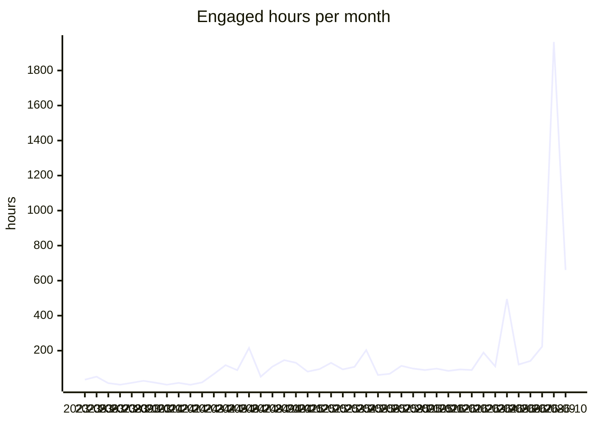

# VFB usage report

Generated 2026-10-26 from aggregate Google Analytics 4 counts for property 375054915, covering 2023-05-10 to 2026-10-25. Source tables: [`analytics/ga4/`](analytics/ga4/). Only summed counts are stored; nothing here identifies a user.

**Reading the numbers.** A large and growing share of 'users' and 'sessions' is automated traffic that loads one page and leaves within a second. Engaged hours (time with the page in the foreground) is barely touched by that traffic and is the most reliable measure of real use; seconds per session shows how bot-heavy a row is.

## Yearly totals

| year | peak monthly users | sessions | screenPageViews | engaged hours | sec/session |
|---|---|---|---|---|---|
| 2023 | 1,332 | 13,668 | 42,490 | 172.9 | 45.5 |
| 2024 | 4,045 | 62,091 | 465,976 | 1,046.3 | 60.7 |
| 2025 | 53,078 | 174,980 | 961,769 | 1,240.7 | 25.5 |
| 2026 | 330,801 | 1,492,001 | 4,005,412 | 4,086.9 | 9.9 |

## Monthly trend

| month | activeUsers | newUsers | sessions | screenPageViews | engaged hours | sec/session |
|---|---|---|---|---|---|---|
| 2024-11 | 2,756 | 2,307 | 7,746 | 71,342 | 131.2 | 61.0 |
| 2024-12 | 2,996 | 2,325 | 6,433 | 42,248 | 80.3 | 45.0 |
| 2025-01 | 2,711 | 1,830 | 7,149 | 57,703 | 94.5 | 47.6 |
| 2025-02 | 2,483 | 1,473 | 6,460 | 69,682 | 130.5 | 72.7 |
| 2025-03 | 2,594 | 1,923 | 7,298 | 70,667 | 93.3 | 46.0 |
| 2025-04 | 2,961 | 2,158 | 5,752 | 46,050 | 107.5 | 67.3 |
| 2025-05 | 2,634 | 1,976 | 5,584 | 49,953 | 203.4 | 131.1 |
| 2025-06 | 2,044 | 1,803 | 5,615 | 39,033 | 60.9 | 39.0 |
| 2025-07 | 1,950 | 1,514 | 6,599 | 43,636 | 67.9 | 37.0 |
| 2025-08 | 3,396 | 3,134 | 8,653 | 67,983 | 113.5 | 47.2 |
| 2025-09 | 8,753 | 10,370 | 15,167 | 293,319 | 97.7 | 23.2 |
| 2025-10 | 15,773 | 15,259 | 19,431 | 62,052 | 89.3 | 16.5 |
| 2025-11 | 53,078 | 51,557 | 55,532 | 92,601 | 97.5 | 6.3 |
| 2025-12 | 27,089 | 26,632 | 30,314 | 69,090 | 84.8 | 10.1 |
| 2026-01 | 35,882 | 35,655 | 41,654 | 84,515 | 93.1 | 8.0 |
| 2026-02 | 33,896 | 33,815 | 38,136 | 81,618 | 89.5 | 8.5 |
| 2026-03 | 90,461 | 89,967 | 95,391 | 204,564 | 189.0 | 7.1 |
| 2026-04 | 81,384 | 81,647 | 85,778 | 152,209 | 110.6 | 4.6 |
| 2026-05 | 330,801 | 328,117 | 328,909 | 419,823 | 495.2 | 5.4 |
| 2026-06 | 118,372 | 120,130 | 125,861 | 215,401 | 120.8 | 3.5 |
| 2026-07 | 202,893 | 200,564 | 203,206 | 285,273 | 141.3 | 2.5 |
| 2026-08 | 114,152 | 116,038 | 121,133 | 261,249 | 223.3 | 6.6 |
| 2026-09 | 180,888 | 183,665 | 230,953 | 1,586,357 | 1,963.3 | 30.6 |
| 2026-10 | 210,939 | 202,119 | 221,967 | 714,403 | 660.8 | 10.7 |

## By site, last 12 months

Page views with no host name are the v2 viewer's in-app term changes and are counted under the viewer.

| site | sessions | screenPageViews | engaged hours | sec/session |
|---|---|---|---|---|
| v2 viewer | 703,067 | 2,930,359 | 2,789.7 | 14.3 |
| www / docs | 806,295 | 904,866 | 1,033.3 | 4.6 |
| other VFB services | 193,632 | 204,927 | 457.7 | 8.5 |
| CATMAID | 38,479 | 38,336 | 41.9 | 3.9 |
| other / mirrors | 83,822 | 8,726 | 20.0 | 0.9 |
| legacy Edinburgh hosts | 141,451 | 141,911 | 15.9 | 0.4 |
| VFBchat | 26 | 30 | 0.0 | 0.4 |

## Countries, last 12 months

Ranked by engaged hours. 212 countries in total.

| country | users (sum of months) | sessions | engaged hours | sec/session |
|---|---|---|---|---|
| United States | 117,231 | 159,102 | 1,358.1 | 30.7 |
| United Kingdom | 16,716 | 27,188 | 709.2 | 93.9 |
| Germany | 14,703 | 22,795 | 192.7 | 30.4 |
| India | 14,749 | 17,885 | 188.5 | 37.9 |
| China | 272,266 | 276,585 | 160.7 | 2.1 |
| Puerto Rico | 231 | 1,660 | 154.7 | 335.5 |
| Canada | 7,778 | 11,366 | 105.5 | 33.4 |
| Brazil | 20,001 | 21,598 | 82.6 | 13.8 |
| Russia | 6,251 | 8,096 | 73.7 | 32.8 |
| Australia | 4,124 | 6,183 | 72.0 | 41.9 |
| Hong Kong | 81,975 | 81,663 | 64.5 | 2.8 |
| Singapore | 843,256 | 837,238 | 62.8 | 0.3 |
| Chile | 2,662 | 3,223 | 59.5 | 66.4 |
| Japan | 9,876 | 11,881 | 59.0 | 17.9 |
| Türkiye | 5,191 | 6,493 | 49.0 | 27.2 |
| France | 4,387 | 5,902 | 46.8 | 28.5 |
| Poland | 3,605 | 4,764 | 46.3 | 35.0 |
| Mexico | 6,755 | 7,554 | 45.8 | 21.8 |
| Spain | 3,116 | 4,188 | 41.7 | 35.9 |
| Italy | 2,616 | 3,307 | 37.5 | 40.8 |
| South Korea | 1,590 | 3,074 | 34.8 | 40.8 |
| Indonesia | 13,142 | 13,724 | 32.7 | 8.6 |
| Pakistan | 4,266 | 4,499 | 31.5 | 25.2 |
| Netherlands | 3,261 | 4,034 | 30.7 | 27.4 |
| Philippines | 5,070 | 5,432 | 27.6 | 18.3 |
| (not set) | 1,023 | 980 | 26.6 | 97.8 |
| Argentina | 5,018 | 5,468 | 25.3 | 16.7 |
| Israel | 1,575 | 2,250 | 24.0 | 38.4 |
| Taiwan | 951 | 1,650 | 23.3 | 50.8 |
| Thailand | 2,396 | 2,895 | 22.5 | 28.0 |

## Cities, last 12 months

GA4 has no institution or network dimension, so city is the nearest proxy for where labs are. Cities with fewer than 5 users in a month are not stored. Data-centre cities (Ashburn, Council Bluffs, Singapore and similar) show up with near-zero seconds per session.

| city | country | months seen | sessions | engaged hours | sec/session |
|---|---|---|---|---|---|
| Dunblane | United Kingdom | 1 | 84 | 361.1 | 15,475.0 |
| Hong Kong | Hong Kong | 13 | 81,103 | 61.6 | 2.7 |
| Singapore | Singapore | 13 | 816,571 | 53.4 | 0.2 |
| San Juan | Puerto Rico | 7 | 698 | 51.9 | 267.6 |
| Santiago | Chile | 11 | 1,712 | 45.9 | 96.6 |
| London | United Kingdom | 13 | 5,000 | 43.1 | 31.1 |
| New York | United States | 13 | 4,423 | 37.1 | 30.2 |
| Los Angeles | United States | 13 | 3,084 | 29.6 | 34.6 |
| Chicago | United States | 13 | 5,335 | 27.2 | 18.4 |
| Munich | Germany | 11 | 488 | 24.7 | 182.5 |
| Frederick | United States | 1 | 17 | 24.7 | 5,235.5 |
| Moscow | Russia | 11 | 2,367 | 24.5 | 37.3 |
| Bengaluru | India | 11 | 1,926 | 23.1 | 43.2 |
| Karachi | Pakistan | 9 | 912 | 21.3 | 84.2 |
| Round Rock | United States | 2 | 49 | 21.2 | 1,556.3 |
| Phoenix | United States | 9 | 4,532 | 19.4 | 15.4 |
| Cambridge | United Kingdom | 13 | 1,898 | 19.0 | 36.1 |
| San Jose | United States | 13 | 4,746 | 18.8 | 14.2 |
| Istanbul | Türkiye | 12 | 2,212 | 18.5 | 30.2 |
| Sydney | Australia | 9 | 1,819 | 17.1 | 33.8 |
| Edinburgh | United Kingdom | 10 | 438 | 16.8 | 138.5 |
| Cologne | Germany | 11 | 732 | 16.1 | 79.1 |
| Toronto | Canada | 13 | 1,655 | 15.8 | 34.4 |
| Miami | United States | 10 | 721 | 15.8 | 78.7 |
| Flint Hill | United States | 7 | 4,762 | 15.6 | 11.8 |
| Houston | United States | 13 | 2,000 | 15.5 | 27.9 |
| Melbourne | Australia | 9 | 1,386 | 15.3 | 39.7 |
| Boston | United States | 13 | 1,972 | 15.2 | 27.7 |
| Dallas | United States | 13 | 1,807 | 15.0 | 29.9 |
| Athens | United States | 4 | 366 | 15.0 | 147.4 |
| Atlanta | United States | 12 | 1,132 | 13.6 | 43.2 |
| Philadelphia | United States | 13 | 1,301 | 13.1 | 36.1 |
| Warsaw | Poland | 13 | 1,550 | 13.0 | 30.2 |
| Brisbane | Australia | 8 | 962 | 12.9 | 48.2 |
| Beijing | China | 13 | 3,718 | 12.7 | 12.3 |
| Shanghai | China | 13 | 7,709 | 12.0 | 5.6 |
| Seoul | South Korea | 13 | 1,077 | 12.0 | 40.3 |
| Urumqi | China | 4 | 40,186 | 11.8 | 1.1 |
| Berlin | Germany | 13 | 1,048 | 11.7 | 40.3 |
| Paris | France | 13 | 1,104 | 10.8 | 35.3 |
| Vienna | Austria | 13 | 707 | 10.8 | 55.0 |
| Seattle | United States | 12 | 1,311 | 10.7 | 29.4 |
| Rostock | Germany | 2 | 144 | 10.7 | 268.7 |
| Shenzhen | China | 13 | 1,830 | 10.4 | 20.4 |
| Bangkok | Thailand | 8 | 1,267 | 10.2 | 28.9 |
| Mumbai | India | 12 | 963 | 9.9 | 37.0 |
| Ashburn | United States | 13 | 5,273 | 9.6 | 6.5 |
| Mexico City | Mexico | 10 | 1,422 | 9.4 | 23.8 |
| Des Moines | United States | 10 | 3,307 | 9.3 | 10.1 |
| Sao Paulo | Brazil | 11 | 1,872 | 9.2 | 17.7 |

## Most viewed terms

Taken from the term id in viewer URLs and `/reports/` and `/term/` pages. The adult brain template leads because it is the default scene, not because people search for it.

### Last 30 days

| term | label | views | engaged hours | days seen |
|---|---|---|---|---|
| VFB_00101567 | JRC2018Unisex | 195,671 | 293.3 | 30 |
| FBbt_00003624 | adult brain | 33,446 | 16.7 | 30 |
| FBbt_00003748 | medulla | 15,487 | 6.5 | 30 |
| FBbt_00003681 | adult lateral accessory lobe | 12,078 | 4.9 | 30 |
| FBbt_00040041 | vest | 11,171 | 2.9 | 30 |
| FBbt_00003680 | nodulus | 10,456 | 1.2 | 30 |
| FBbt_00005093 | nervous system | 10,205 | 4.1 | 30 |
| FBbt_00003004 | adult | 8,970 | 2.9 | 30 |
| FBbt_00045048 | saddle | 8,171 | 50.9 | 30 |
| FBbt_00040043 | anterior ventrolateral protocerebrum | 8,032 | 3.3 | 30 |
| VFB_00108w0p | BANC:brain_neuropil on JRC2018Unisex | 7,795 | 3.0 | 30 |
| FBbt_00047887 | adult central brain | 6,285 | 1.6 | 30 |
| FBbt_00007146 | adult deutocerebrum | 6,276 | 0.2 | 29 |
| FBbt_00040042 | posterior ventrolateral protocerebrum | 5,302 | 2.0 | 30 |
| FBbt_00045027 | wedge | 4,515 | 1.6 | 30 |
| FBbt_00003678 | ellipsoid body | 4,414 | 1.8 | 30 |
| FBbt_00014013 | adult gnathal ganglion | 4,189 | 1.4 | 30 |
| VFB_00102107 | ME on JRC2018Unisex adult brain | 3,513 | 1.2 | 30 |
| VFB_jrchk7yg | WEDPN2A_R (FlyEM-HB:885788485) | 3,354 | 0.3 | 29 |
| FBbt_00007050 | adult cerebrum | 3,343 | 0.7 | 30 |
| FBbt_00053384 | adult primary visual center | 3,243 | 0.9 | 30 |
| FBbt_00045050 | flange | 3,161 | 1.3 | 30 |
| VFB_00030866 | adult central complex on adult brain template JFRC2 | 3,114 | 0.6 | 12 |
| FBbt_00003632 | adult central complex | 3,082 | 0.8 | 30 |
| FBbt_00045051 | cantle | 2,931 | 0.3 | 30 |

### Last 12 months

| term | label | views | engaged hours | days seen |
|---|---|---|---|---|
| VFB_00101567 | JRC2018Unisex | 841,768 | 1,635.3 | 365 |
| FBbt_00003624 | adult brain | 85,341 | 48.2 | 333 |
| FBbt_00003748 | medulla | 66,452 | 38.8 | 345 |
| FBbt_00003681 | adult lateral accessory lobe | 53,514 | 27.7 | 339 |
| FBbt_00040041 | vest | 44,966 | 22.2 | 323 |
| FBbt_00005093 | nervous system | 39,283 | 19.6 | 307 |
| FBbt_00040043 | anterior ventrolateral protocerebrum | 37,637 | 19.4 | 301 |
| FBbt_00045048 | saddle | 36,359 | 63.7 | 303 |
| FBbt_00003004 | adult | 34,124 | 16.2 | 285 |
| FBbt_00003680 | nodulus | 33,399 | 8.0 | 247 |
| FBbt_00047887 | adult central brain | 27,793 | 9.4 | 280 |
| FBbt_00040042 | posterior ventrolateral protocerebrum | 25,745 | 12.3 | 289 |
| FBbt_00003678 | ellipsoid body | 20,954 | 12.6 | 287 |
| VFB_jrchk7yg | WEDPN2A_R (FlyEM-HB:885788485) | 20,128 | 5.8 | 159 |
| FBbt_00014013 | adult gnathal ganglion | 19,968 | 12.3 | 276 |
| FBbt_00045027 | wedge | 19,297 | 8.7 | 277 |
| VFB_00050000 | L1 larval CNS ssTEM - Cardona/Janelia | 17,561 | 29.8 | 323 |
| FBbt_00007050 | adult cerebrum | 16,676 | 6.1 | 262 |
| VFB_00108w0p | BANC:brain_neuropil on JRC2018Unisex | 16,639 | 6.6 | 49 |
| VFB_00102107 | ME on JRC2018Unisex adult brain | 15,709 | 10.9 | 245 |
| FBbt_00045050 | flange | 14,111 | 6.4 | 242 |
| FBbt_00003632 | adult central complex | 13,443 | 4.6 | 203 |
| FBbt_00110636 | adult cerebral ganglion | 13,029 | 5.2 | 247 |
| FBbt_00053384 | adult primary visual center | 12,963 | 5.9 | 209 |
| FBbt_00003679 | fan-shaped body | 12,624 | 6.5 | 260 |

### All time

| term | label | views | engaged hours | days seen |
|---|---|---|---|---|
| VFB_00101567 | JRC2018Unisex | 1,039,968 | 1,871.9 | 984 |
| FBbt_00003624 | adult brain | 98,481 | 71.6 | 871 |
| FBbt_00003748 | medulla | 76,082 | 59.2 | 862 |
| FBbt_00003681 | adult lateral accessory lobe | 59,972 | 41.8 | 834 |
| FBbt_00040041 | vest | 51,190 | 33.6 | 806 |
| FBbt_00040043 | anterior ventrolateral protocerebrum | 42,840 | 29.2 | 729 |
| FBbt_00005093 | nervous system | 40,860 | 22.0 | 442 |
| FBbt_00045048 | saddle | 40,724 | 72.4 | 740 |
| FBbt_00003004 | adult | 36,492 | 18.8 | 482 |
| FBbt_00003680 | nodulus | 35,185 | 11.8 | 535 |
| FBbt_00047887 | adult central brain | 32,319 | 15.8 | 656 |
| FBbt_00040042 | posterior ventrolateral protocerebrum | 29,000 | 19.3 | 682 |
| VFB_00050000 | L1 larval CNS ssTEM - Cardona/Janelia | 25,308 | 42.5 | 802 |
| FBbt_00003678 | ellipsoid body | 24,056 | 19.2 | 641 |
| FBbt_00014013 | adult gnathal ganglion | 23,644 | 20.6 | 641 |
| FBbt_00045027 | wedge | 21,947 | 14.7 | 637 |
| VFB_jrchk7yg | WEDPN2A_R (FlyEM-HB:885788485) | 20,299 | 6.6 | 172 |
| FBbt_00007050 | adult cerebrum | 19,530 | 10.3 | 555 |
| VFB_00102107 | ME on JRC2018Unisex adult brain | 19,464 | 15.6 | 531 |
| FBbt_00003679 | fan-shaped body | 18,012 | 12.5 | 597 |
| VFB_00030867 | adult mushroom body on adult brain template JFRC2 | 17,450 | 13.2 | 447 |
| VFB_00108w0p | BANC:brain_neuropil on JRC2018Unisex | 16,639 | 6.6 | 49 |
| FBbt_00045050 | flange | 16,138 | 10.8 | 536 |
| FBbt_00110636 | adult cerebral ganglion | 15,549 | 8.3 | 541 |
| FBbt_00003632 | adult central complex | 15,353 | 8.3 | 409 |

### Templates in use, last 12 months

| template | label | views |
|---|---|---|
| VFB_00101567 | JRC2018Unisex | 1,402,727 |
| VFB_00050000 | L1 larval CNS ssTEM - Cardona/Janelia | 33,895 |
| VFB_00017894 | adult brain template JFRC2 | 18,938 |
| VFB_00200000 | JRC2018UnisexVNC | 16,484 |
| VFB_00049000 | L3 CNS template - Wood2018 | 9,387 |
| VFB_00101384 | JRC_FlyEM_Hemibrain | 3,963 |
| VFB_00110000 | Adult Head (McKellar2020) | 3,474 |
| VFB_00120000 | Adult T1 Leg (Kuan2020) | 2,125 |
| FBbt_00003624 | adult brain | 1,383 |
| VFB_00100000 | adult VNS template - Court2018 | 1,154 |

## Website and documentation pages, last 12 months

| pagePath | screenPageViews | engaged hours |
|---|---|---|
| / | 204,764 | 599.4 |
| /docs/ | 18,814 | 43.0 |
| /about/ | 6,264 | 27.4 |
| /docs/overview/ | 4,063 | 23.1 |
| /blog/releases/catmaid/ | 518 | 22.2 |
| /docs/data/ | 6,188 | 20.5 |
| /docs/tutorials/vfb-mcp-guide/ | 1,803 | 10.6 |
| /docs/website-features/3dviewer/ | 2,681 | 10.0 |
| /hosted/ | 2,927 | 5.9 |
| /docs/tutorials/ | 2,504 | 5.8 |
| /docs/contribution-guidelines/ | 1,335 | 5.4 |
| /about/whichfly/ | 497 | 5.0 |
| /docs/concepts/flylight_tiles/ | 608 | 3.6 |
| /docs/apis/ | 738 | 3.6 |
| /docs/tutorials/apis/ | 780 | 3.6 |
| /docs/website-features/search_query/ | 802 | 3.5 |
| /blog/news/ | 1,543 | 3.4 |
| /blog/2026/09/06/vfb-self-led-learning-sessions-a-free-online-workshop-open-to-everyone/ | 1,053 | 3.1 |
| /docs/website-features/ | 1,097 | 2.9 |
| /about/hosted/ | 959 | 2.7 |
| /docs/concepts/ | 559 | 2.6 |
| /docs/data/em/ | 475 | 2.4 |
| /docs/tutorials/apis/vfb_api_overview/ | 355 | 2.3 |
| /docs/tutorials/website/similarityscore/ | 338 | 2.2 |
| /docs/concepts/neuron-counts/ | 288 | 2.2 |
| /docs/concepts/cell_types/ | 369 | 2.2 |
| /docs/tools/ | 402 | 2.1 |
| /about/whatisvfb/ | 601 | 2.0 |
| /docs/data/connectivity/ | 282 | 2.0 |
| /docs/concepts/bridging/ | 223 | 1.9 |

## How people arrive

Engaged sessions by channel and year.

| channel | 2023 | 2024 | 2025 | 2026 |
|---|---|---|---|---|
| (other) | 0 | 0 | 0 | 0 |
| AI Assistant | 0 | 0 | 0 | 2,427 |
| Direct | 1,628 | 10,737 | 124,445 | 1,267,673 |
| Organic Search | 3,198 | 18,605 | 30,520 | 187,222 |
| Organic Shopping | 0 | 3 | 2 | 0 |
| Organic Social | 7 | 454 | 125 | 1,400 |
| Organic Video | 0 | 2 | 0 | 128 |
| Referral | 495 | 18,973 | 11,071 | 9,137 |
| Unassigned | 0 | 6 | 60 | 1,471 |

Top sources, last 12 months.

| sessionSource | sessions | engaged hours |
|---|---|---|
| google | 180,790 | 2,368.8 |
| (direct) | 1,358,229 | 1,262.8 |
| bing | 12,949 | 271.6 |
| (not set) | 17,475 | 58.2 |
| chatgpt.com | 2,733 | 38.1 |
| yahoo | 782 | 30.9 |
| duckduckgo | 2,607 | 30.2 |
| cn.bing.com | 818 | 28.4 |
| flybase.org | 951 | 15.4 |
| splitgal4.janelia.org | 1,559 | 14.7 |
| codex.flywire.ai | 1,940 | 14.4 |
| gemini.google.com | 554 | 13.3 |
| ecosia.org | 782 | 9.7 |
| github.com | 624 | 9.2 |
| moodle.carleton.edu | 120 | 6.3 |
| trafficheap.com | 502 | 5.8 |
| trafficheap.cc | 502 | 5.8 |
| science.org | 156 | 5.3 |
| en.wikipedia.org | 325 | 5.2 |
| janelia.org | 240 | 5.1 |
| search.brave.com | 287 | 4.3 |
| yandex.ru | 251 | 4.0 |
| neuronbridge.janelia.org | 99 | 3.9 |
| doubao.com | 80 | 3.4 |
| translate.google.com | 206 | 3.2 |

## Queries run in the viewer, last 12 months

| query | runs |
|---|---|
| allalignedimages | 4,450 |
| imagesneurons | 2,054 |
| listallavailableimages | 1,554 |
| neuronneuronconnectivit | 1,275 |
| neuronregionconnectivit | 857 |
| similarmorphologyto | 819 |
| alldatasets | 770 |
| neuronsparthere | 762 |
| aligneddatasets | 758 |
| findstocks | 719 |
| anatomyexpressedin | 489 |
| partsof | 437 |
| painteddomains | 340 |
| upstreamclassconnectivi | 303 |
| subclassesof | 281 |
| downstreamclassconnecti | 276 |
| neuronssynaptic | 212 |
| epfrag | 201 |
| similarmorphologytonb | 192 |
| neuronspostsynaptichere | 151 |
| neuronspresynaptichere | 139 |
| transgeneexpressionhere | 138 |
| similarmorphologytopart | 133 |
| datasetimages | 131 |
| expressioncluster | 80 |

## VFBchat and MCP

| month | chat_query | mcp_tool_call |
|---|---|---|
| 2026-02 | 70 | 492 |
| 2026-03 | 354 | 2,258 |
| 2026-04 | 575 | 7,992 |
| 2026-05 | 17 | 971 |
| 2026-06 | 358 | 30,858 |
| 2026-07 | 9 | 18,938 |
| 2026-08 | 1,017 | 89,583 |
| 2026-09 | 797 | 84,835 |
| 2026-10 | 194 | 11,230 |

## Viewer reliability

| month | session_start | disconnected | reconnected-resumed | reconnect-failed-reloading | reconnect-exhausted | disconnects per 100 sessions |
|---|---|---|---|---|---|---|
| 2025-05 | 2,675 | 1,436 | 0 | 101 | 0 | 53.7 |
| 2025-06 | 3,466 | 1,365 | 0 | 12 | 0 | 39.4 |
| 2025-07 | 4,662 | 2,057 | 0 | 18 | 0 | 44.1 |
| 2025-08 | 6,571 | 1,680 | 0 | 17 | 0 | 25.6 |
| 2025-09 | 6,265 | 1,170 | 0 | 24 | 0 | 18.7 |
| 2025-10 | 7,777 | 1,232 | 0 | 17 | 0 | 15.8 |
| 2025-11 | 8,460 | 1,163 | 0 | 24 | 0 | 13.7 |
| 2025-12 | 10,434 | 1,359 | 0 | 8 | 0 | 13.0 |
| 2026-01 | 21,913 | 1,530 | 0 | 30 | 0 | 7.0 |
| 2026-02 | 24,790 | 1,536 | 0 | 31 | 0 | 6.2 |
| 2026-03 | 23,808 | 5,059 | 0 | 465 | 0 | 21.2 |
| 2026-04 | 23,996 | 2,933 | 0 | 33 | 0 | 12.2 |
| 2026-05 | 55,407 | 2,314 | 0 | 44 | 0 | 4.2 |
| 2026-06 | 23,505 | 2,149 | 0 | 158 | 0 | 9.1 |
| 2026-07 | 45,208 | 2,280 | 0 | 49 | 0 | 5.0 |
| 2026-08 | 24,841 | 3,675 | 0 | 530 | 0 | 14.8 |
| 2026-09 | 51,588 | 75,199 | 30,436 | 38,791 | 1,919 | 145.8 |
| 2026-10 | 91,607 | 15,099 | 6,573 | 7,432 | 584 | 16.5 |

Load times from the timing suffix on viewer events (months with at least 100 samples).

| month | event | n | median s | p95 s |
|---|---|---|---|---|
| 2026-09 | direct-geom:obj:ok | 61,923 | 1.4 | 25.4 |
| 2026-10 | direct-geom:obj:ok | 72,910 | 3.4 | 10.9 |
| 2026-09 | direct-terminfo:ok | 109,210 | 0.4 | 3.0 |
| 2026-10 | direct-terminfo:ok | 185,346 | 0.6 | 2.2 |
| 2026-09 | startup-first-term | 50,164 | 5.2 | 58.0 |
| 2026-10 | startup-first-term | 63,956 | 6.0 | 22.0 |
| 2026-09 | startup-model | 54,086 | 2.8 | 25.0 |
| 2026-10 | startup-model | 104,154 | 1.4 | 6.1 |
| 2026-09 | term-load:ok | 104,726 | 1.0 | 45.0 |
| 2026-10 | term-load:ok | 119,731 | 2.5 | 11.0 |

## Outbound links clicked, last 12 months

| linkDomain | clicks |
|---|---|
| neuronbridge.janelia.org | 1,419 |
| pypi.org | 1,305 |
| virtualflybrain.org | 1,292 |
| github.com | 902 |
| v2.virtualflybrain.org | 674 |
| insectbraindb.org | 615 |
| flweb.janelia.org | 431 |
| colab.research.google.com | 381 |
| translate.google.com | 354 |
| doi.org | 330 |
| flybase.org | 196 |
| chat.virtualflybrain.org | 87 |
| codex.flywire.ai | 82 |
| virtualflybrain.bsky.social | 81 |
| google.com | 57 |
| vfb3-mcp.virtualflybrain.org | 55 |
| neurofly.org | 50 |
| neuprint.janelia.org | 44 |
| janelia.org | 41 |
| ncbi.nlm.nih.gov | 26 |

## Devices and browsers, last 12 months

| deviceCategory | browser | sessions | engaged hours |
|---|---|---|---|
| desktop | Chrome | 1,441,962 | 2,702.5 |
| desktop | Edge | 20,565 | 434.4 |
| mobile | Chrome | 45,890 | 332.1 |
| desktop | Safari | 14,423 | 202.9 |
| desktop | Firefox | 11,455 | 198.3 |
| desktop | Opera | 13,665 | 166.4 |
| mobile | Safari | 32,638 | 155.9 |
| tablet | Chrome | 2,639 | 34.9 |
| tablet | Safari | 951 | 11.7 |
| mobile | Firefox | 1,235 | 10.7 |
| mobile | Samsung Internet | 1,517 | 10.7 |
| desktop | YaBrowser | 514 | 7.7 |

## What this data cannot show

- **Institutions.** GA4 dropped the network-domain dimension and never exposes IP addresses. City is as close as it gets.
- **Search terms typed into VFB.** The viewer does not send a `search` event, so `searchTerm` is empty. Term popularity above comes from term ids in URLs.
- **Event detail.** No custom dimensions are registered on the property, so event parameters (`event_label`, `event_category`, and the VFBchat and MCP parameters such as tool name and topic) are discarded from reports. Registration is not retroactive.
- **Yearly unique users.** Users do not add up across days or months; only daily and monthly uniques are stored.
