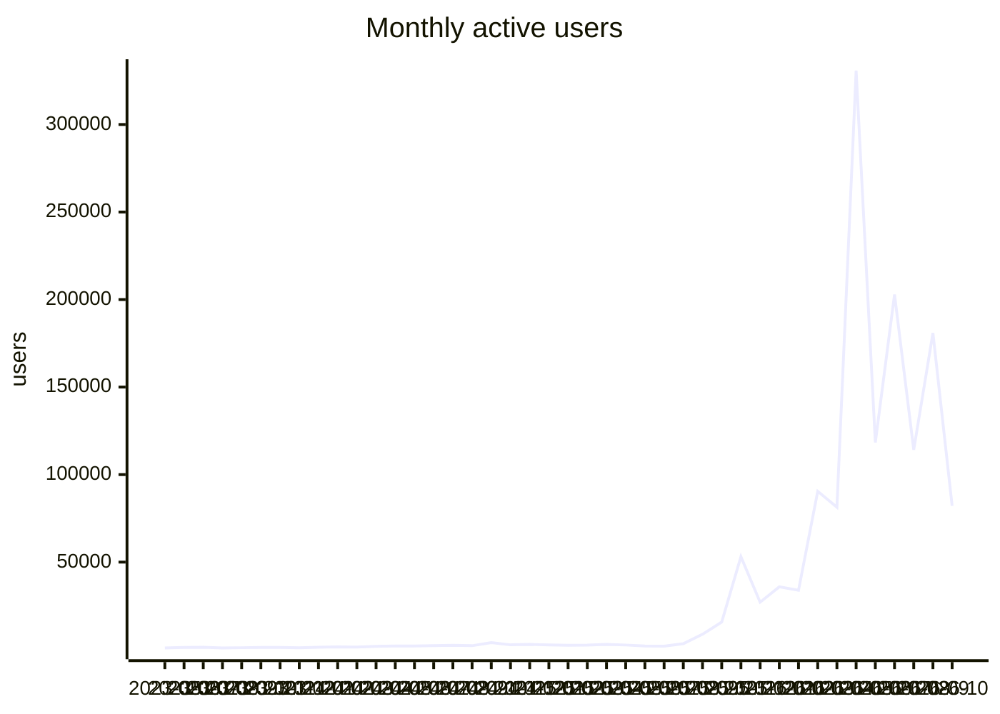

# VFB usage report

Generated 2026-10-19 from aggregate Google Analytics 4 counts for property 375054915, covering 2023-05-10 to 2026-10-18. Source tables: [`analytics/ga4/`](analytics/ga4/). Only summed counts are stored; nothing here identifies a user.

**Reading the numbers.** A large and growing share of 'users' and 'sessions' is automated traffic that loads one page and leaves within a second. Engaged hours (time with the page in the foreground) is barely touched by that traffic and is the most reliable measure of real use; seconds per session shows how bot-heavy a row is.

## Yearly totals

| year | peak monthly users | sessions | screenPageViews | engaged hours | sec/session |
|---|---|---|---|---|---|
| 2023 | 1,332 | 13,668 | 42,490 | 172.9 | 45.5 |
| 2024 | 4,045 | 62,091 | 465,976 | 1,046.3 | 60.7 |
| 2025 | 53,078 | 174,980 | 961,769 | 1,240.7 | 25.5 |
| 2026 | 330,801 | 1,361,378 | 3,670,446 | 3,857.9 | 10.2 |

## Monthly trend

| month | activeUsers | newUsers | sessions | screenPageViews | engaged hours | sec/session |
|---|---|---|---|---|---|---|
| 2024-11 | 2,756 | 2,307 | 7,746 | 71,342 | 131.2 | 61.0 |
| 2024-12 | 2,996 | 2,325 | 6,433 | 42,248 | 80.3 | 45.0 |
| 2025-01 | 2,711 | 1,830 | 7,149 | 57,703 | 94.5 | 47.6 |
| 2025-02 | 2,483 | 1,473 | 6,460 | 69,682 | 130.5 | 72.7 |
| 2025-03 | 2,594 | 1,923 | 7,298 | 70,667 | 93.3 | 46.0 |
| 2025-04 | 2,961 | 2,158 | 5,752 | 46,050 | 107.5 | 67.3 |
| 2025-05 | 2,634 | 1,976 | 5,584 | 49,953 | 203.4 | 131.1 |
| 2025-06 | 2,044 | 1,803 | 5,615 | 39,033 | 60.9 | 39.0 |
| 2025-07 | 1,950 | 1,514 | 6,599 | 43,636 | 67.9 | 37.0 |
| 2025-08 | 3,396 | 3,134 | 8,653 | 67,983 | 113.5 | 47.2 |
| 2025-09 | 8,753 | 10,370 | 15,167 | 293,319 | 97.7 | 23.2 |
| 2025-10 | 15,773 | 15,259 | 19,431 | 62,052 | 89.3 | 16.5 |
| 2025-11 | 53,078 | 51,557 | 55,532 | 92,601 | 97.5 | 6.3 |
| 2025-12 | 27,089 | 26,632 | 30,314 | 69,090 | 84.8 | 10.1 |
| 2026-01 | 35,882 | 35,655 | 41,654 | 84,515 | 93.1 | 8.0 |
| 2026-02 | 33,896 | 33,815 | 38,136 | 81,618 | 89.5 | 8.5 |
| 2026-03 | 90,461 | 89,967 | 95,391 | 204,564 | 189.0 | 7.1 |
| 2026-04 | 81,384 | 81,647 | 85,778 | 152,209 | 110.6 | 4.6 |
| 2026-05 | 330,801 | 328,117 | 328,909 | 419,823 | 495.2 | 5.4 |
| 2026-06 | 118,372 | 120,130 | 125,861 | 215,401 | 120.8 | 3.5 |
| 2026-07 | 202,893 | 200,564 | 203,206 | 285,273 | 141.3 | 2.5 |
| 2026-08 | 114,152 | 116,038 | 121,133 | 261,249 | 223.3 | 6.6 |
| 2026-09 | 180,888 | 183,665 | 230,953 | 1,586,357 | 1,963.3 | 30.6 |
| 2026-10 | 82,156 | 80,657 | 90,180 | 379,437 | 431.7 | 17.2 |

## By site, last 12 months

Page views with no host name are the v2 viewer's in-app term changes and are counted under the viewer.

| site | sessions | screenPageViews | engaged hours | sec/session |
|---|---|---|---|---|
| v2 viewer | 581,253 | 2,652,792 | 2,601.3 | 16.1 |
| www / docs | 753,584 | 849,540 | 998.0 | 4.8 |
| other VFB services | 193,397 | 204,499 | 453.9 | 8.4 |
| CATMAID | 38,364 | 38,223 | 41.1 | 3.9 |
| other / mirrors | 83,702 | 8,537 | 19.3 | 0.8 |
| legacy Edinburgh hosts | 140,106 | 140,568 | 15.8 | 0.4 |
| VFBchat | 26 | 30 | 0.0 | 0.4 |

## Countries, last 12 months

Ranked by engaged hours. 210 countries in total.

| country | users (sum of months) | sessions | engaged hours | sec/session |
|---|---|---|---|---|
| United States | 112,049 | 152,822 | 1,310.6 | 30.9 |
| United Kingdom | 16,098 | 26,447 | 648.4 | 88.3 |
| Germany | 14,047 | 22,030 | 188.5 | 30.8 |
| India | 14,418 | 17,475 | 183.4 | 37.8 |
| Puerto Rico | 219 | 1,648 | 154.7 | 337.9 |
| China | 249,253 | 252,884 | 142.4 | 2.0 |
| Canada | 7,501 | 11,031 | 103.0 | 33.6 |
| Brazil | 18,971 | 20,557 | 80.9 | 14.2 |
| Russia | 6,064 | 7,822 | 72.9 | 33.6 |
| Australia | 3,957 | 5,973 | 69.9 | 42.2 |
| Singapore | 815,673 | 809,665 | 62.1 | 0.3 |
| Chile | 2,541 | 3,087 | 58.5 | 68.2 |
| Japan | 9,467 | 11,431 | 57.3 | 18.0 |
| Türkiye | 5,103 | 6,381 | 48.0 | 27.1 |
| France | 4,153 | 5,648 | 45.4 | 28.9 |
| Mexico | 6,410 | 7,196 | 45.3 | 22.6 |
| Poland | 3,461 | 4,581 | 43.9 | 34.5 |
| Spain | 2,973 | 4,004 | 40.2 | 36.1 |
| Italy | 2,507 | 3,178 | 36.0 | 40.8 |
| South Korea | 1,544 | 2,987 | 33.7 | 40.6 |
| Indonesia | 12,609 | 13,173 | 31.9 | 8.7 |
| Pakistan | 4,121 | 4,348 | 31.1 | 25.7 |
| Netherlands | 3,147 | 3,897 | 29.9 | 27.6 |
| (not set) | 1,010 | 967 | 26.6 | 99.1 |
| Philippines | 4,923 | 5,271 | 26.5 | 18.1 |
| Argentina | 4,731 | 5,179 | 24.4 | 17.0 |
| Israel | 1,526 | 2,194 | 23.4 | 38.4 |
| Taiwan | 933 | 1,615 | 22.8 | 50.8 |
| Thailand | 2,238 | 2,695 | 20.3 | 27.1 |
| Ukraine | 3,545 | 4,039 | 20.0 | 17.9 |

## Cities, last 12 months

GA4 has no institution or network dimension, so city is the nearest proxy for where labs are. Cities with fewer than 5 users in a month are not stored. Data-centre cities (Ashburn, Council Bluffs, Singapore and similar) show up with near-zero seconds per session.

| city | country | months seen | sessions | engaged hours | sec/session |
|---|---|---|---|---|---|
| Dunblane | United Kingdom | 1 | 84 | 361.1 | 15,475.0 |
| Singapore | Singapore | 13 | 789,198 | 52.8 | 0.2 |
| San Juan | Puerto Rico | 7 | 695 | 51.9 | 268.8 |
| Santiago | Chile | 11 | 1,641 | 45.3 | 99.4 |
| London | United Kingdom | 13 | 4,870 | 41.4 | 30.6 |
| New York | United States | 13 | 4,250 | 35.4 | 30.0 |
| Los Angeles | United States | 13 | 2,985 | 28.9 | 34.9 |
| Chicago | United States | 13 | 5,221 | 26.9 | 18.5 |
| Frederick | United States | 1 | 17 | 24.7 | 5,235.5 |
| Munich | Germany | 11 | 476 | 24.5 | 185.0 |
| Moscow | Russia | 11 | 2,295 | 24.2 | 38.0 |
| Bengaluru | India | 11 | 1,883 | 22.7 | 43.4 |
| Karachi | Pakistan | 9 | 879 | 21.2 | 86.6 |
| Round Rock | United States | 2 | 49 | 21.2 | 1,556.3 |
| Cambridge | United Kingdom | 13 | 1,886 | 19.0 | 36.3 |
| Phoenix | United States | 9 | 4,313 | 18.2 | 15.2 |
| Istanbul | Türkiye | 12 | 2,177 | 18.0 | 29.8 |
| San Jose | United States | 13 | 4,422 | 17.3 | 14.0 |
| Sydney | Australia | 9 | 1,775 | 16.8 | 34.2 |
| Cologne | Germany | 11 | 726 | 16.1 | 79.7 |
| Miami | United States | 10 | 693 | 15.5 | 80.3 |
| Toronto | Canada | 13 | 1,598 | 15.5 | 34.8 |
| Edinburgh | United Kingdom | 10 | 395 | 15.1 | 137.4 |
| Flint Hill | United States | 7 | 4,622 | 15.1 | 11.7 |
| Boston | United States | 13 | 1,939 | 15.0 | 27.9 |
| Athens | United States | 4 | 348 | 14.9 | 153.8 |
| Melbourne | Australia | 9 | 1,338 | 14.8 | 39.8 |
| Houston | United States | 13 | 1,929 | 14.5 | 27.1 |
| Dallas | United States | 13 | 1,734 | 14.4 | 30.0 |
| Atlanta | United States | 12 | 1,089 | 13.2 | 43.7 |
| Philadelphia | United States | 13 | 1,253 | 12.7 | 36.6 |
| Brisbane | Australia | 8 | 923 | 12.5 | 48.8 |
| Hong Kong | Hong Kong | 13 | 13,160 | 12.4 | 3.4 |
| Warsaw | Poland | 13 | 1,501 | 12.1 | 29.1 |
| Seoul | South Korea | 13 | 1,053 | 11.7 | 40.0 |
| Shanghai | China | 13 | 7,690 | 11.7 | 5.5 |
| Berlin | Germany | 13 | 1,020 | 11.4 | 40.2 |
| Beijing | China | 13 | 2,698 | 11.1 | 14.8 |
| Rostock | Germany | 2 | 144 | 10.7 | 268.7 |
| Vienna | Austria | 13 | 687 | 10.6 | 55.4 |
| Paris | France | 13 | 1,075 | 10.6 | 35.4 |
| Seattle | United States | 12 | 1,275 | 10.4 | 29.4 |
| Shenzhen | China | 13 | 1,811 | 10.1 | 20.1 |
| Mumbai | India | 12 | 943 | 9.8 | 37.3 |
| Bangkok | Thailand | 8 | 1,192 | 9.6 | 28.9 |
| Ashburn | United States | 13 | 5,055 | 9.4 | 6.7 |
| Mexico City | Mexico | 10 | 1,373 | 9.4 | 24.6 |
| Des Moines | United States | 10 | 3,298 | 9.3 | 10.1 |
| Sao Paulo | Brazil | 11 | 1,782 | 9.0 | 18.2 |
| Delhi | India | 9 | 1,113 | 8.7 | 28.0 |

## Most viewed terms

Taken from the term id in viewer URLs and `/reports/` and `/term/` pages. The adult brain template leads because it is the default scene, not because people search for it.

### Last 30 days

| term | label | views | engaged hours | days seen |
|---|---|---|---|---|
| VFB_00101567 | JRC2018Unisex | 246,173 | 450.5 | 30 |
| FBbt_00003624 | adult brain | 52,182 | 25.7 | 30 |
| FBbt_00003748 | medulla | 22,919 | 9.9 | 30 |
| FBbt_00003681 | adult lateral accessory lobe | 19,335 | 7.9 | 30 |
| FBbt_00040041 | vest | 17,132 | 5.8 | 30 |
| FBbt_00003004 | adult | 16,224 | 5.1 | 30 |
| FBbt_00005093 | nervous system | 16,191 | 6.2 | 30 |
| FBbt_00003680 | nodulus | 15,475 | 2.0 | 30 |
| FBbt_00040043 | anterior ventrolateral protocerebrum | 12,992 | 5.4 | 30 |
| FBbt_00045048 | saddle | 12,463 | 5.2 | 30 |
| VFB_00108w0p | BANC:brain_neuropil on JRC2018Unisex | 11,574 | 4.4 | 30 |
| FBbt_00047887 | adult central brain | 9,940 | 2.8 | 30 |
| FBbt_00040042 | posterior ventrolateral protocerebrum | 9,758 | 3.7 | 30 |
| FBbt_00045027 | wedge | 7,049 | 2.7 | 30 |
| FBbt_00007146 | adult deutocerebrum | 6,964 | 0.3 | 29 |
| FBbt_00014013 | adult gnathal ganglion | 6,922 | 2.6 | 30 |
| FBbt_00003678 | ellipsoid body | 6,823 | 3.2 | 30 |
| FBbt_00007050 | adult cerebrum | 5,322 | 1.1 | 30 |
| FBbt_00045050 | flange | 5,034 | 1.8 | 30 |
| VFB_00102107 | ME on JRC2018Unisex adult brain | 4,993 | 2.4 | 30 |
| FBbt_00053384 | adult primary visual center | 4,721 | 2.1 | 30 |
| FBbt_00003632 | adult central complex | 4,571 | 1.2 | 30 |
| FBbt_00040039 | gorget | 4,443 | 0.1 | 25 |
| FBbt_00110636 | adult cerebral ganglion | 4,432 | 1.9 | 30 |
| FBbt_00003679 | fan-shaped body | 4,046 | 1.3 | 30 |

### Last 12 months

| term | label | views | engaged hours | days seen |
|---|---|---|---|---|
| VFB_00101567 | JRC2018Unisex | 786,717 | 1,613.3 | 365 |
| FBbt_00003624 | adult brain | 79,191 | 46.2 | 331 |
| FBbt_00003748 | medulla | 63,873 | 38.0 | 343 |
| FBbt_00003681 | adult lateral accessory lobe | 51,672 | 27.4 | 337 |
| FBbt_00040041 | vest | 43,692 | 22.1 | 322 |
| FBbt_00005093 | nervous system | 37,680 | 19.2 | 303 |
| FBbt_00040043 | anterior ventrolateral protocerebrum | 36,309 | 18.7 | 298 |
| FBbt_00045048 | saddle | 35,086 | 15.9 | 301 |
| FBbt_00003004 | adult | 32,961 | 15.9 | 283 |
| FBbt_00003680 | nodulus | 32,721 | 7.9 | 244 |
| FBbt_00047887 | adult central brain | 26,609 | 9.3 | 279 |
| FBbt_00040042 | posterior ventrolateral protocerebrum | 24,998 | 12.2 | 285 |
| FBbt_00003678 | ellipsoid body | 20,209 | 12.6 | 285 |
| VFB_jrchk7yg | WEDPN2A_R (FlyEM-HB:885788485) | 19,432 | 5.7 | 153 |
| FBbt_00014013 | adult gnathal ganglion | 19,250 | 12.2 | 274 |
| FBbt_00045027 | wedge | 18,507 | 8.5 | 276 |
| VFB_00050000 | L1 larval CNS ssTEM - Cardona/Janelia | 17,393 | 29.4 | 322 |
| FBbt_00007050 | adult cerebrum | 16,073 | 6.0 | 261 |
| VFB_00108w0p | BANC:brain_neuropil on JRC2018Unisex | 15,524 | 6.3 | 42 |
| VFB_00102107 | ME on JRC2018Unisex adult brain | 15,235 | 10.8 | 240 |
| FBbt_00045050 | flange | 13,655 | 6.4 | 240 |
| FBbt_00003632 | adult central complex | 13,013 | 4.6 | 199 |
| FBbt_00110636 | adult cerebral ganglion | 12,602 | 5.1 | 243 |
| FBbt_00053384 | adult primary visual center | 12,313 | 5.8 | 205 |
| FBbt_00003679 | fan-shaped body | 12,234 | 6.5 | 259 |

### All time

| term | label | views | engaged hours | days seen |
|---|---|---|---|---|
| VFB_00101567 | JRC2018Unisex | 982,682 | 1,846.8 | 977 |
| FBbt_00003624 | adult brain | 92,211 | 69.4 | 864 |
| FBbt_00003748 | medulla | 73,439 | 58.4 | 855 |
| FBbt_00003681 | adult lateral accessory lobe | 58,100 | 41.4 | 827 |
| FBbt_00040041 | vest | 49,856 | 33.3 | 799 |
| FBbt_00040043 | anterior ventrolateral protocerebrum | 41,494 | 28.5 | 722 |
| FBbt_00045048 | saddle | 39,423 | 24.5 | 733 |
| FBbt_00005093 | nervous system | 39,230 | 21.6 | 435 |
| FBbt_00003004 | adult | 35,310 | 18.3 | 475 |
| FBbt_00003680 | nodulus | 34,478 | 11.7 | 528 |
| FBbt_00047887 | adult central brain | 31,089 | 15.6 | 649 |
| FBbt_00040042 | posterior ventrolateral protocerebrum | 28,233 | 19.2 | 675 |
| VFB_00050000 | L1 larval CNS ssTEM - Cardona/Janelia | 25,013 | 42.0 | 795 |
| FBbt_00003678 | ellipsoid body | 23,268 | 19.1 | 634 |
| FBbt_00014013 | adult gnathal ganglion | 22,899 | 20.5 | 634 |
| FBbt_00045027 | wedge | 21,131 | 14.5 | 630 |
| VFB_jrchk7yg | WEDPN2A_R (FlyEM-HB:885788485) | 19,603 | 6.5 | 166 |
| VFB_00102107 | ME on JRC2018Unisex adult brain | 18,924 | 15.5 | 524 |
| FBbt_00007050 | adult cerebrum | 18,889 | 10.2 | 548 |
| FBbt_00003679 | fan-shaped body | 17,487 | 12.5 | 590 |
| VFB_00030867 | adult mushroom body on adult brain template JFRC2 | 17,229 | 13.1 | 440 |
| FBbt_00045050 | flange | 15,657 | 10.7 | 529 |
| VFB_00108w0p | BANC:brain_neuropil on JRC2018Unisex | 15,524 | 6.3 | 42 |
| FBbt_00110636 | adult cerebral ganglion | 15,099 | 8.2 | 534 |
| FBbt_00003632 | adult central complex | 14,911 | 8.2 | 402 |

### Templates in use, last 12 months

| template | label | views |
|---|---|---|
| VFB_00101567 | JRC2018Unisex | 1,295,661 |
| VFB_00050000 | L1 larval CNS ssTEM - Cardona/Janelia | 33,648 |
| VFB_00017894 | adult brain template JFRC2 | 18,259 |
| VFB_00200000 | JRC2018UnisexVNC | 13,350 |
| VFB_00049000 | L3 CNS template - Wood2018 | 8,856 |
| VFB_00110000 | Adult Head (McKellar2020) | 3,293 |
| VFB_00101384 | JRC_FlyEM_Hemibrain | 2,381 |
| VFB_00120000 | Adult T1 Leg (Kuan2020) | 1,386 |
| FBbt_00003624 | adult brain | 1,383 |
| VFB_00030786 | adult brain template Ito2014 | 986 |

## Website and documentation pages, last 12 months

| pagePath | screenPageViews | engaged hours |
|---|---|---|
| / | 191,312 | 577.8 |
| /docs/ | 18,058 | 41.0 |
| /about/ | 6,051 | 26.5 |
| /docs/overview/ | 3,923 | 22.2 |
| /blog/releases/catmaid/ | 507 | 22.1 |
| /docs/data/ | 5,961 | 19.4 |
| /docs/tutorials/vfb-mcp-guide/ | 1,758 | 10.4 |
| /docs/website-features/3dviewer/ | 2,581 | 9.7 |
| /hosted/ | 2,840 | 5.7 |
| /docs/tutorials/ | 2,422 | 5.6 |
| /docs/contribution-guidelines/ | 1,284 | 5.2 |
| /about/whichfly/ | 474 | 4.9 |
| /docs/apis/ | 708 | 3.5 |
| /docs/concepts/flylight_tiles/ | 595 | 3.5 |
| /docs/tutorials/apis/ | 764 | 3.5 |
| /docs/website-features/search_query/ | 770 | 3.3 |
| /blog/news/ | 1,478 | 3.2 |
| /about/hosted/ | 968 | 3.1 |
| /blog/2026/09/06/vfb-self-led-learning-sessions-a-free-online-workshop-open-to-everyone/ | 1,010 | 3.0 |
| /docs/website-features/ | 1,046 | 2.8 |
| /docs/concepts/ | 546 | 2.6 |
| /docs/data/em/ | 451 | 2.3 |
| /docs/tutorials/website/similarityscore/ | 332 | 2.2 |
| /docs/concepts/cell_types/ | 359 | 2.2 |
| /docs/concepts/neuron-counts/ | 281 | 2.2 |
| /docs/tutorials/apis/vfb_api_overview/ | 347 | 2.2 |
| /docs/tools/ | 396 | 2.1 |
| /about/whatisvfb/ | 594 | 2.0 |
| /docs/concepts/bridging/ | 217 | 1.9 |
| /search/ | 585 | 1.9 |

## How people arrive

Engaged sessions by channel and year.

| channel | 2023 | 2024 | 2025 | 2026 |
|---|---|---|---|---|
| AI Assistant | 0 | 0 | 0 | 2,361 |
| Direct | 1,628 | 10,737 | 124,445 | 1,150,571 |
| Organic Search | 3,198 | 18,605 | 30,520 | 181,249 |
| Organic Shopping | 0 | 3 | 2 | 0 |
| Organic Social | 7 | 454 | 125 | 1,381 |
| Organic Video | 0 | 2 | 0 | 64 |
| Referral | 495 | 18,973 | 11,071 | 8,892 |
| Unassigned | 0 | 6 | 60 | 1,466 |

Top sources, last 12 months.

| sessionSource | sessions | engaged hours |
|---|---|---|
| google | 175,873 | 2,255.9 |
| (direct) | 1,242,701 | 1,190.6 |
| bing | 12,338 | 260.3 |
| (not set) | 9,524 | 52.2 |
| chatgpt.com | 2,699 | 38.0 |
| yahoo | 748 | 30.1 |
| duckduckgo | 2,524 | 28.9 |
| cn.bing.com | 811 | 27.9 |
| flybase.org | 956 | 15.5 |
| splitgal4.janelia.org | 1,558 | 14.9 |
| codex.flywire.ai | 1,962 | 14.3 |
| gemini.google.com | 541 | 12.7 |
| ecosia.org | 760 | 9.5 |
| github.com | 620 | 9.2 |
| moodle.carleton.edu | 120 | 6.3 |
| science.org | 167 | 6.2 |
| trafficheap.cc | 502 | 5.8 |
| trafficheap.com | 502 | 5.8 |
| en.wikipedia.org | 328 | 5.3 |
| janelia.org | 241 | 4.6 |
| search.brave.com | 276 | 4.1 |
| neuronbridge.janelia.org | 109 | 4.1 |
| yandex.ru | 249 | 4.0 |
| doubao.com | 80 | 3.4 |
| flweb.janelia.org | 219 | 3.2 |

## Queries run in the viewer, last 12 months

| query | runs |
|---|---|
| allalignedimages | 4,024 |
| imagesneurons | 1,684 |
| alldatasets | 677 |
| aligneddatasets | 667 |
| neuronsparthere | 597 |
| listallavailableimages | 516 |
| partsof | 311 |
| painteddomains | 308 |
| neuronssynaptic | 180 |
| subclassesof | 136 |
| neuronneuronconnectivit | 132 |
| neuronspostsynaptichere | 112 |
| datasetimages | 111 |
| neuronspresynaptichere | 109 |
| transgeneexpressionhere | 71 |
| expressioncluster | 66 |
| tractsnervesinnervating | 61 |
| similarmorphologyto | 56 |
| termsforpub | 38 |
| lineageclonesin | 38 |
| findstocks | 37 |
| upstreamclassconnectivi | 34 |
| downstreamclassconnecti | 32 |
| anatscrnaseqquery | 30 |
| neuronregionconnectivit | 22 |

## VFBchat and MCP

| month | chat_query | mcp_tool_call |
|---|---|---|
| 2026-02 | 70 | 492 |
| 2026-03 | 354 | 2,258 |
| 2026-04 | 575 | 7,992 |
| 2026-05 | 17 | 971 |
| 2026-06 | 358 | 30,858 |
| 2026-07 | 9 | 18,938 |
| 2026-08 | 1,017 | 89,583 |
| 2026-09 | 797 | 84,835 |
| 2026-10 | 164 | 4,114 |

## Viewer reliability

| month | session_start | disconnected | reconnected-resumed | reconnect-failed-reloading | reconnect-exhausted | disconnects per 100 sessions |
|---|---|---|---|---|---|---|
| 2025-05 | 2,675 | 1,436 | 0 | 101 | 0 | 53.7 |
| 2025-06 | 3,466 | 1,365 | 0 | 12 | 0 | 39.4 |
| 2025-07 | 4,662 | 2,057 | 0 | 18 | 0 | 44.1 |
| 2025-08 | 6,571 | 1,680 | 0 | 17 | 0 | 25.6 |
| 2025-09 | 6,265 | 1,170 | 0 | 24 | 0 | 18.7 |
| 2025-10 | 7,777 | 1,232 | 0 | 17 | 0 | 15.8 |
| 2025-11 | 8,460 | 1,163 | 0 | 24 | 0 | 13.7 |
| 2025-12 | 10,434 | 1,359 | 0 | 8 | 0 | 13.0 |
| 2026-01 | 21,913 | 1,530 | 0 | 30 | 0 | 7.0 |
| 2026-02 | 24,790 | 1,536 | 0 | 31 | 0 | 6.2 |
| 2026-03 | 23,808 | 5,059 | 0 | 465 | 0 | 21.2 |
| 2026-04 | 23,996 | 2,933 | 0 | 33 | 0 | 12.2 |
| 2026-05 | 55,407 | 2,314 | 0 | 44 | 0 | 4.2 |
| 2026-06 | 23,505 | 2,149 | 0 | 158 | 0 | 9.1 |
| 2026-07 | 45,208 | 2,280 | 0 | 49 | 0 | 5.0 |
| 2026-08 | 24,841 | 3,675 | 0 | 530 | 0 | 14.8 |
| 2026-09 | 51,588 | 75,199 | 30,436 | 38,791 | 1,919 | 145.8 |
| 2026-10 | 21,205 | 15,021 | 6,573 | 7,432 | 581 | 70.8 |

Load times from the timing suffix on viewer events (months with at least 100 samples).

| month | event | n | median s | p95 s |
|---|---|---|---|---|
| 2026-09 | direct-geom:obj:ok | 61,923 | 1.4 | 25.4 |
| 2026-10 | direct-geom:obj:ok | 30,557 | 1.8 | 42.2 |
| 2026-09 | direct-terminfo:ok | 109,210 | 0.4 | 3.0 |
| 2026-10 | direct-terminfo:ok | 60,193 | 0.5 | 3.7 |
| 2026-09 | startup-first-term | 50,164 | 5.2 | 58.0 |
| 2026-10 | startup-first-term | 26,144 | 5.2 | 57.0 |
| 2026-09 | startup-model | 54,086 | 2.8 | 25.0 |
| 2026-10 | startup-model | 30,959 | 2.6 | 10.0 |
| 2026-09 | term-load:ok | 104,726 | 1.0 | 45.0 |
| 2026-10 | term-load:ok | 55,737 | 0.9 | 42.0 |

## Outbound links clicked, last 12 months

| linkDomain | clicks |
|---|---|
| neuronbridge.janelia.org | 1,416 |
| pypi.org | 1,268 |
| virtualflybrain.org | 1,178 |
| github.com | 882 |
| v2.virtualflybrain.org | 661 |
| insectbraindb.org | 588 |
| flweb.janelia.org | 430 |
| colab.research.google.com | 362 |
| translate.google.com | 337 |
| doi.org | 308 |
| flybase.org | 192 |
| chat.virtualflybrain.org | 87 |
| virtualflybrain.bsky.social | 80 |
| codex.flywire.ai | 79 |
| google.com | 57 |
| vfb3-mcp.virtualflybrain.org | 52 |
| neurofly.org | 49 |
| neuprint.janelia.org | 41 |
| janelia.org | 40 |
| ncbi.nlm.nih.gov | 24 |

## Devices and browsers, last 12 months

| deviceCategory | browser | sessions | engaged hours |
|---|---|---|---|
| desktop | Chrome | 1,317,958 | 2,542.3 |
| desktop | Edge | 19,784 | 421.2 |
| mobile | Chrome | 44,643 | 320.9 |
| desktop | Safari | 13,964 | 198.9 |
| desktop | Firefox | 11,306 | 194.1 |
| desktop | Opera | 13,317 | 161.3 |
| mobile | Safari | 31,623 | 150.7 |
| tablet | Chrome | 2,518 | 33.5 |
| tablet | Safari | 908 | 10.8 |
| mobile | Firefox | 1,209 | 10.5 |
| mobile | Samsung Internet | 1,464 | 10.5 |
| desktop | YaBrowser | 501 | 7.7 |

## What this data cannot show

- **Institutions.** GA4 dropped the network-domain dimension and never exposes IP addresses. City is as close as it gets.
- **Search terms typed into VFB.** The viewer does not send a `search` event, so `searchTerm` is empty. Term popularity above comes from term ids in URLs.
- **Event detail.** No custom dimensions are registered on the property, so event parameters (`event_label`, `event_category`, and the VFBchat and MCP parameters such as tool name and topic) are discarded from reports. Registration is not retroactive.
- **Yearly unique users.** Users do not add up across days or months; only daily and monthly uniques are stored.
